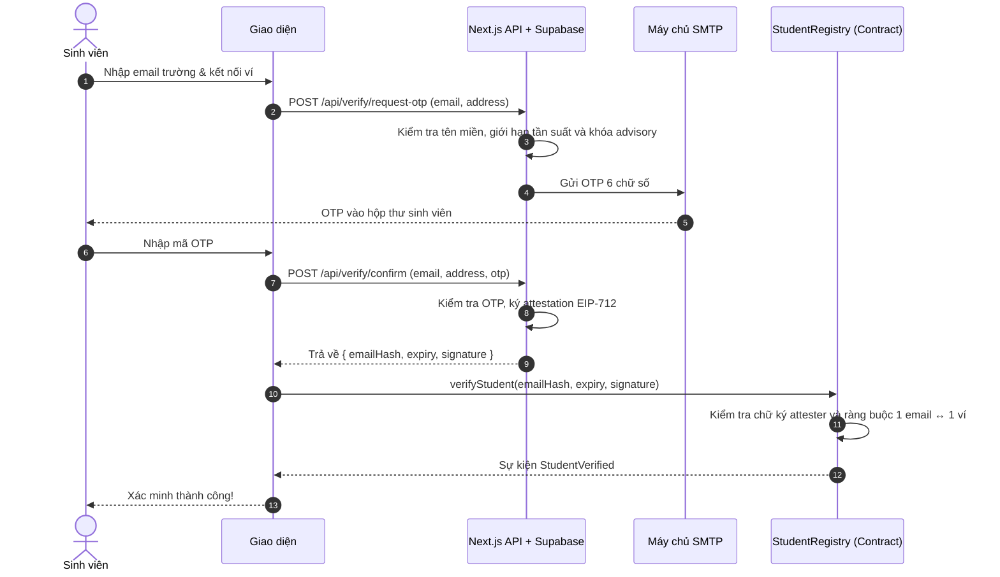
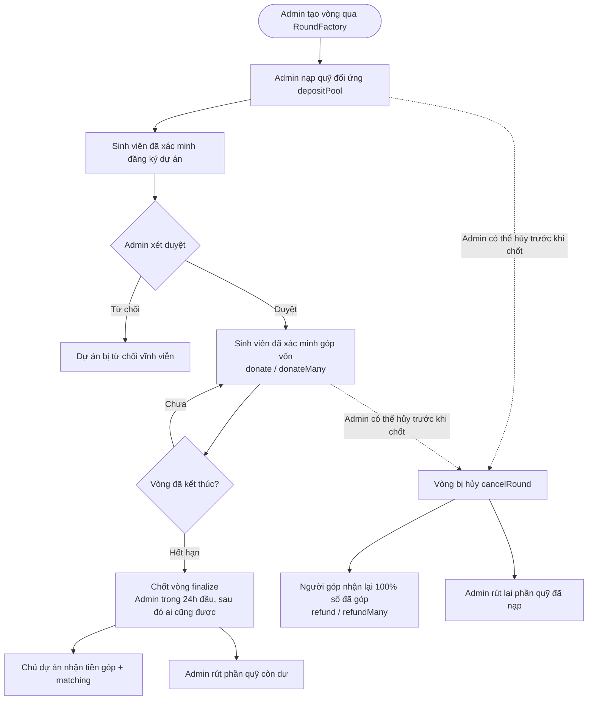

# SqrtFund — Democratic Quadratic Funding for Student Initiatives

> **Topic 6: Avalanche Hackathon (Team1 Vietnam)**  
> **Team:** 43xTSD  
> **Network:** Avalanche Fuji Testnet (Chain ID: `43113`)  
> **Live Web Application:** [https://www.sqrtfund.tech/](https://www.sqrtfund.tech/)  
> **Demo Video:** [Điền link YouTube/Loom demo video tại đây]  
> **Pitch Deck / Slides:** [Điền link Google Slides / PDF pitch deck tại đây]  

---

## Tóm tắt

**SqrtFund** là nền tảng gây quỹ cho câu lạc bộ và dự án sinh viên, dùng cơ chế **Quadratic Funding (QF)** trên **Avalanche Fuji**.

* **Vấn đề:** Quỹ hoạt động sinh viên thường được chia theo quan hệ hoặc theo người "nói to nhất". Dự án được nhiều bạn quan tâm nhưng không có người bảo trợ thì không nhận được gì.
* **Giải pháp:** Nhà tài trợ nạp một quỹ đối ứng. Sinh viên đã xác minh bằng email trường góp những khoản nhỏ (1–5 USDC) cho dự án mình thích. Quỹ đối ứng được chia theo **số người ủng hộ**, không theo số tiền. Ví dụ: 100 ví góp 1 USDC nhận matching thô gấp khoảng **5,2 lần** so với 20 ví góp 5 USDC, dù cùng tổng 100 USDC.
* **Điểm chính:** Công thức QF chạy hoàn toàn on-chain; xác minh sinh viên một lần bằng email trường + OTP + chữ ký EIP-712 và dùng chung cho mọi vòng; hỗ trợ quyên góp theo lô (`donateMany`), hủy vòng khẩn cấp và hoàn tiền 100% cho người góp.

---

## 1. Dự án làm gì

### Vấn đề

Câu lạc bộ sinh viên và các nhóm nghiên cứu nhỏ rất khó xin được kinh phí:

1. **Phân bổ theo quan hệ:** Quỹ về tay người có quan hệ hoặc người thuyết trình "to tiếng" nhất.
2. **Người giàu quyết định:** Trong gây quỹ thông thường, vài khoản góp lớn chi phối toàn bộ kết quả.
3. **Thiếu minh bạch:** Tiền đi qua tài khoản ngân hàng riêng, không có dấu vết hay lịch sử công khai trên sổ cái.

### Giải pháp: Quadratic Funding

Nhà tài trợ cung cấp một quỹ đối ứng (Matching Pool). Sinh viên đã xác minh góp những khoản nhỏ cho dự án mình quan tâm. Khi vòng kết thúc, quỹ được chia theo công thức QF — công thức này thưởng cho **số người ủng hộ** thay vì số tiền:

$$\text{Match}_j \propto \left(\sum_{i} \sqrt{d_{i,j}}\right)^2 - \sum_{i} d_{i,j}$$

trong đó $d_{i,j}$ là khoản sinh viên $i$ góp cho dự án $j$. Dự án có nhiều sinh viên ủng hộ nhận matching cao hơn nhiều so với dự án chỉ có một người góp lớn.

### Vai trò trong hệ thống

| Vai trò | Có thể làm gì |
| :--- | :--- |
| **Sinh viên đã xác minh** | Xác minh email trường một lần; góp 1–5 USDC cho dự án (từng dự án hoặc theo lô), trong giới hạn ngân sách của vòng. |
| **Chủ dự án / CLB** | Là sinh viên đã xác minh, đăng ký dự án, theo dõi matching dự kiến theo thời gian thực, và nhận tiền góp cộng matching sau khi vòng được chốt. |
| **Admin vòng / Nhà tài trợ** | Tạo vòng qua `RoundFactory`, nạp quỹ đối ứng, duyệt hoặc từ chối dự án, chốt vòng, và có thể hủy vòng trước khi chốt. |

### Tính năng

* **Xác minh sinh viên:** Email trường (`.edu`, `.edu.vn`) + OTP + attestation EIP-712, lưu một lần trong `StudentRegistry` dùng chung và có hiệu lực cho mọi vòng.
* **Factory nhiều vòng:** Mỗi vòng là một contract `QFRound` riêng, có thời gian, giới hạn góp, ngân sách và trần matching riêng.
* **Duyệt dự án:** Sinh viên đã xác minh đăng ký dự án; admin vòng duyệt hoặc từ chối vĩnh viễn trên chain.
* **Góp đơn lẻ và theo lô:** `donate` cho một dự án hoặc `donateMany` để chia ngân sách cho nhiều dự án trong một giao dịch duy nhất (cần approve ERC-20 nếu allowance chưa đủ).
* **Bộ máy QF on-chain:** Tính bằng số nguyên với độ chính xác $\text{SCALE} = 10^{12}$, kèm tính toán mô phỏng matching dự kiến ngay trên giao diện khi sinh viên nhập số tiền.
* **Chống thiếu quỹ:** Nếu tổng nhu cầu matching vượt quá quỹ, các khoản chi được giảm theo tỷ lệ tương ứng.
* **Trần matching mỗi dự án:** `maxMatchBps` giới hạn phần trăm tối đa của quỹ mà một dự án được nhận.
* **Chốt vòng hai bước:** Admin được chốt trong 24 giờ ân hạn sau `endTime`; sau đó bất kỳ ai cũng có thể gọi chốt vòng.
* **Nhận tiền trực tiếp:** Chủ dự án nhận tiền góp cộng matching thẳng từ contract của vòng.
* **Hủy vòng và hoàn tiền:** Admin có thể hủy vòng trước khi chốt; người góp sau đó nhận lại 100% số đã góp (`refund` / `refundMany`), và admin chỉ rút lại phần quỹ do chính mình nạp.

---

## 2. Cách hoạt động

### Xác minh sinh viên (Student Verification)



> **Lưu ý:** Attestation do khóa attester ở backend ký, còn contract tự kiểm tra chữ ký, thời hạn và ràng buộc một email một ví. Đây không phải là email zero-knowledge (ZK-Email).

### Vòng đời một vòng gọi vốn (Round Lifecycle)



---

## 3. Toán học của Quadratic Funding

Với các dự án đã duyệt $j = 1 \dots M$ và các khoản góp $d_{i,j}$ của sinh viên đã xác minh $i$:

1. **Tổng căn bậc hai:**  
   $$S_j = \sum_i \sqrt{d_{i,j}}$$
2. **Matching thô:**  
   $$\text{raw}_j = \max\left(0,\ \dfrac{S_j^2}{\text{SCALE}} - \sum_i d_{i,j}\right)$$
3. **Khớp với quỹ đối ứng:**  
   Nếu $\sum_j \text{raw}_j > \text{Pool}$ thì:
   $$\text{base}_j = \left\lfloor \dfrac{\text{Pool} \cdot \text{raw}_j}{\sum_j \text{raw}_j} \right\rfloor$$
   Ngược lại:
   $$\text{base}_j = \text{raw}_j$$
4. **Trần mỗi dự án:**  
   $$\text{cap} = \left\lfloor \dfrac{\text{Pool} \cdot \text{maxMatchBps}}{10000} \right\rfloor \quad \text{và} \quad \text{payout}_j = \min(\text{base}_j, \text{cap})$$
5. **Phần dư:**  
   $$\text{Remainder} = \text{Pool} - \sum_j \text{payout}_j \quad \text{(rút về cho admin)}$$

### Ví dụ so sánh

So sánh trường hợp 100 ví góp 1 USDC mỗi ví với 20 ví góp 5 USDC mỗi ví. Cả hai dự án đều nhận được cùng 100 USDC tiền góp trực tiếp:

| Kịch bản | Tiền góp trực tiếp | Matching thô |
| :--- | :---: | :---: |
| **100 ví × 1 USDC** | 100 USDC | **9.900 USDC** |
| **20 ví × 5 USDC** | 100 USDC | **1.900 USDC** |

Tỷ lệ matching thô chênh lệch khoảng **5,2 lần**. Với quỹ 10.000 USDC, tổng nhu cầu ($11.800$) vượt quỹ nên các khoản chi được giảm theo tỷ lệ xuống còn khoảng $8.390$ và $1.610$ USDC. Nếu có trần $30\%$, dự án thứ nhất bị giới hạn ở $3.000$ USDC.

> Tỷ lệ thô không phải là tỷ lệ nhận tiền thực tế: số tiền thật còn phụ thuộc vào quy mô quỹ và trần áp dụng.

### Tham số của vòng

| Tham số | Ý nghĩa |
| :--- | :--- |
| `minDonation` / `maxDonation` | Khoản góp nhỏ nhất một lần và tổng nhiều nhất một sinh viên được góp cho một dự án (ví dụ: 1 và 5 USDC). |
| `maxPerRound` | Tổng số tiền một sinh viên được chi cho mọi dự án trong một vòng (ví dụ: 10 USDC). |
| `maxMatchBps` | Trần matching mỗi dự án, tính theo điểm cơ bản (bps, $100\text{ bps} = 1\%$) của quỹ đối ứng. |
| `MAX_PROJECTS = 50` | Số dự án tối đa mỗi vòng, để hàm `finalize` luôn chạy trong $O(N)$ có giới hạn gas. |
| `MAX_PROJECTS_PER_OWNER = 2` | Hạn chế một địa chỉ ví đăng ký quá nhiều dự án. |

`finalize` lặp qua tối đa 50 dự án. Một kiểm thử Foundry cục bộ với 50 dự án đo được khoảng 1,58 triệu gas cho lệnh gọi này.

---

## 4. Chống lạm dụng

QF chỉ công bằng khi mỗi ví đại diện cho một con người thực. SqrtFund thiết lập nhiều lớp bảo vệ:

| Lớp bảo vệ | Thực thi bởi | Mục đích ngăn chặn |
| :--- | :--- | :--- |
| **Chỉ email trường** | Backend kiểm tra tên miền (`.edu`, `.edu.vn`) | Bot sử dụng email rác hoặc email dùng một lần. |
| **Một email ↔ một ví** | `StudentRegistry` (`emailOwner`, `walletEmail`) | Một email xác minh nhiều ví, hoặc một ví liên tục đổi email. |
| **Ngân sách mỗi sinh viên** | `spentInRound[donor] <= maxPerRound` on-chain | Giới hạn thiệt hại nếu kẻ tấn công sở hữu nhiều danh tính. |
| **Cộng dồn trước khi lấy căn** | `donationOf` cộng dồn theo ví và dự án | Việc chia 5 USDC thành 5 lần 1 USDC không thể tăng thêm matching. |
| **Giới hạn tần suất và khóa** | Khóa advisory của Supabase, sliding window rate limit | Tấn công tranh chấp đồng thời (race condition) và spam gửi mail OTP. |
| **Duyệt dự án** | Admin duyệt hoặc từ chối từng dự án | Dự án rác, spam hoặc lừa đảo. |

---

## 5. Giả định tin cậy và giới hạn đã biết

1. **Khóa attester:** Backend giữ `ATTESTER_PRIVATE_KEY` và ký attestation cho sinh viên. Nếu khóa bị lộ, kẻ tấn công có thể giả mạo attestation cho đến khi owner đổi khóa bằng `setAttester`. Khóa attester nên là một ví riêng biệt, tách biệt với admin của vòng.
2. **Phạm vi của Supabase:** Cơ sở dữ liệu chỉ phục vụ xác minh email (lưu trữ OTP tạm thời, giới hạn tần suất, nhật ký). Toàn bộ dữ liệu vòng, dự án, khoản góp, matching và payout nằm hoàn toàn on-chain.
3. **Quyền của admin vòng:** Admin duyệt hoặc từ chối dự án, chốt vòng trong 24 giờ ân hạn, và có thể hủy vòng bất kỳ lúc nào trước khi chốt, kể cả sau `endTime`. Khi hủy, người góp luôn nhận lại đủ 100% số đã góp và admin chỉ rút lại phần quỹ do mình nạp, nhưng các dự án sẽ mất phần matching.
4. **Nạp quỹ:** Ở phiên bản hiện tại, chỉ admin vòng được nạp quỹ đối ứng (`depositPool`).
5. **Kiểm duyệt dự án:** Quyết định từ chối là vĩnh viễn trên chain, phát ra sự kiện `ProjectRejected(id)`, không lưu trữ lý do và không có cơ chế kháng nghị on-chain. Dự án bị từ chối vẫn tính vào giới hạn 50 dự án và giới hạn mỗi chủ ví.
6. **Danh tính qua email:** Hộp thư dùng chung hoặc địa chỉ email cựu sinh viên được trường cấp lại có thể tạo thêm danh tính.
7. **Thông đồng (Collusion):** QF thuần túy dễ bị mua chuộc (trả tiền để người khác góp hộ). Cơ chế Pairwise matching nằm trong lộ trình phát triển.
8. **Chưa kiểm toán:** Hợp đồng thông minh chưa qua kiểm toán an mật độc lập từ bên thứ ba.

---

## 6. Lý do thiết kế

### Vì sao on-chain?
Hội đồng xét duyệt truyền thống và bảng tính Excel thiếu tính minh bạch và chậm trễ. Khi triển khai on-chain:
* Công thức matching không thể bị chỉnh sửa hồi tố.
* Mỗi khoản góp là một giao dịch công khai, không thể làm giả.
* Chủ dự án nhận tiền trực tiếp từ smart contract theo quy tắc toán học đã chốt.

### Vì sao Avalanche?
Các khoản góp sinh viên rất nhỏ (1–5 USDC), do đó phí giao dịch là yếu tố sống còn:
* **Avalanche C-Chain** có mức phí cực thấp và tốc độ xác thực (finality) gần như tức thì.
* Sử dụng bộ công cụ EVM tiêu chuẩn, tương thích mượt mà với **Core Wallet**.
* Hàm `donateMany` cho phép sinh viên phân bổ ngân sách cho nhiều dự án trong 1 giao dịch, tối ưu tối đa chi phí gas.

### Tiền matching đến từ đâu?
Không đến từ lợi suất đầu cơ hay lạm phát token. Quỹ matching được tài trợ bởi nhà trường, mạng lưới cựu sinh viên hoặc doanh nghiệp đối tác thông qua hàm `depositPool`. Trong bản demo testnet này, token thử nghiệm là MockUSDC; việc nhà tài trợ nạp quỹ là kịch bản vận hành thực tế.

### Lưu ý pháp lý (Việt Nam)
SqrtFund vận hành thử nghiệm trên mạng Avalanche Fuji với MockUSDC (không có giá trị tiền tệ thực). Đây là công cụ công nghệ phân bổ quỹ tài trợ nghiên cứu/hoạt động, không cấu thành sản phẩm tài chính hoặc đầu tư. Nếu triển khai thực tế với tài sản thật, dự án cần tuân thủ đầy đủ quy định pháp luật Việt Nam về tài sản số và trung gian thanh toán.

---

## 7. Triển khai (Fuji)

Địa chỉ lấy từ `contracts/deployments/fuji.json`:

| Contract | Địa chỉ | Explorer |
| :--- | :--- | :--- |
| **StudentRegistry** | `0xbA0b756Ac2830743Cc56Fb42E504ED4d374Fe58e` | [Snowtrace](https://testnet.snowtrace.io/address/0xbA0b756Ac2830743Cc56Fb42E504ED4d374Fe58e) |
| **RoundFactory** | `0xbC077E28826D0738E56491800bdb8D5725F9e5b3` | [Snowtrace](https://testnet.snowtrace.io/address/0xbC077E28826D0738E56491800bdb8D5725F9e5b3) |
| **MockUSDC** | `0xFf56491e29085043DbB11cd01D54cC1449A3d686` | [Snowtrace](https://testnet.snowtrace.io/address/0xFf56491e29085043DbB11cd01D54cC1449A3d686) |

Bạn có thể kiểm tra trực tiếp các hợp đồng đã triển khai bằng lệnh `cast` của Foundry:

```bash
# 1. Kiểm tra Attester đã đăng ký trong StudentRegistry
cast call 0xbA0b756Ac2830743Cc56Fb42E504ED4d374Fe58e "attester()(address)" \
  --rpc-url https://api.avax-test.network/ext/bc/C/rpc
# Kỳ vọng: 0x5C2001c91aEFFaEDf9ef438cA50Bcddd23ce6181

# 2. Kiểm tra RoundFactory gắn với đúng StudentRegistry
cast call 0xbC077E28826D0738E56491800bdb8D5725F9e5b3 "studentRegistry()(address)" \
  --rpc-url https://api.avax-test.network/ext/bc/C/rpc
# Kỳ vọng: 0xbA0b756Ac2830743Cc56Fb42E504ED4d374Fe58e

# 3. Kiểm tra thông tin MockUSDC
cast call 0xFf56491e29085043DbB11cd01D54cC1449A3d686 "symbol()(string)" \
  --rpc-url https://api.avax-test.network/ext/bc/C/rpc
# Kỳ vọng: "USDC"
```

Mỗi vòng gọi vốn là một contract `QFRound` riêng do factory tạo ra. Để kiểm tra một vòng có dùng đúng StudentRegistry hay không, hãy gọi `studentRegistry()` trên địa chỉ contract của vòng đó.

---

## 8. Bắt đầu

### Yêu cầu tiên quyết
* **Node.js** 20+ và **pnpm**
* **Foundry** (`forge`, `cast`)
* Ví trình duyệt (khuyến nghị **Core Wallet**) kết nối mạng Avalanche Fuji, có một lượng nhỏ AVAX testnet làm gas.

### Cài đặt

```bash
git clone https://github.com/hlbaot/SqrtFund.git
cd SqrtFund
pnpm install
cd contracts && forge build && cd ..
```

### Biến môi trường

Sao chép `.env.example` thành `.env.local` và điền cấu hình phù hợp:

| Biến | Phạm vi | Mô tả |
| :--- | :--- | :--- |
| `NEXT_PUBLIC_CHAIN_ID` | Công khai | `43113` |
| `NEXT_PUBLIC_RPC_URL` | Công khai | `https://api.avax-test.network/ext/bc/C/rpc` |
| `NEXT_PUBLIC_EXPLORER_URL` | Công khai | `https://testnet.snowtrace.io` |
| `NEXT_PUBLIC_STUDENT_REGISTRY_ADDRESS` | Công khai | Địa chỉ hợp đồng `StudentRegistry` |
| `NEXT_PUBLIC_FACTORY_ADDRESS` | Công khai | Địa chỉ hợp đồng `RoundFactory` |
| `NEXT_PUBLIC_USDC_ADDRESS` | Công khai | Địa chỉ token `MockUSDC` |
| `STUDENT_REGISTRY_ADDRESS` | Server | Cùng địa chỉ registry, dùng cho backend API và script |
| `ATTESTER_ADDRESS` | Server | Địa chỉ ví attester ký EIP-712 |
| `ATTESTER_PRIVATE_KEY` | Bí mật | Khóa bí mật của ví attester (chỉ lưu ở server) |
| `OTP_SECRET` | Bí mật | Khóa bí mật dùng để băm mã OTP |
| `SUPABASE_URL` | Server | URL dự án Supabase |
| `SUPABASE_SERVICE_ROLE_KEY` | Bí mật | Khóa service-role Supabase (chỉ dùng ở server) |
| `EMAIL_PROVIDER` | Server | `smtp` hoặc `resend` |
| `SMTP_HOST`, `SMTP_PORT`, `SMTP_FROM` | Server | Cấu hình máy chủ mail SMTP |
| `SMTP_USER`, `SMTP_PASS` | Bí mật | Thông tin xác thực tài khoản gửi mail |
| `ALLOWED_EMAIL_DOMAINS` | Server | Danh sách whitelist tên miền (tùy chọn; để trống sẽ chấp nhận mọi đuôi `.edu` và `.edu.vn`) |

> **Lưu ý:** Chỉ các biến có tiền tố `NEXT_PUBLIC_` mới được gửi tới trình duyệt. Các giá trị này được nhúng cố định khi build.

### Cơ sở dữ liệu

Thực thi file migration `supabase/migrations/0001_verification.sql` trong SQL Editor của Supabase. File này sẽ khởi tạo bảng lưu trữ OTP, dữ liệu xác minh và các hàm khóa advisory chống tranh chấp.

### Chạy và kiểm thử

```bash
# 1. Chạy ứng dụng Next.js ở chế độ phát triển (port 3000)
pnpm dev

# 2. Chạy test smart contract (đơn vị, fuzz và invariant)
cd contracts && forge test && cd ..

# 3. Chạy test frontend và backend API
pnpm test

# 4. Build kiểm tra bản production
pnpm build
```

### Tự triển khai contract

```bash
cd contracts
export STUDENT_REGISTRY_ADDRESS=<địa_chỉ_registry>
forge script script/DeployFactory.s.sol:DeployFactory \
  --rpc-url https://api.avax-test.network/ext/bc/C/rpc \
  --account <keystore_của_bạn> --broadcast
```

Sau khi deploy, cập nhật các biến `NEXT_PUBLIC_*` và file `contracts/deployments/fuji.json`, sau đó tạo vòng mới từ giao diện trang Admin.

---

## 9. Dùng thử ứng dụng

1. **Cài đặt ví:** Cài đặt Core Wallet (hoặc ví EVM tương thích), chuyển mạng sang Avalanche Fuji, nhận AVAX testnet từ [Avalanche Faucet](https://core.app/tools/testnet-faucet/).
2. **Nhận MockUSDC:** Nhận MockUSDC testnet (sử dụng tính năng faucet/mint trên trang Admin hoặc gọi trực tiếp contract).
3. **Xác minh sinh viên:** Mở menu ví trên thanh điều hướng, chọn xác minh email sinh viên. Nhập email có đuôi `.edu` hoặc `.edu.vn`, điền mã OTP nhận được trong hộp thư, và xác nhận giao dịch ghi danh trên ví.
4. **Ủng hộ dự án:** Truy cập trang Vòng gọi vốn, chọn một vòng và dự án muốn hỗ trợ. Khi nhập số tiền, giao diện sẽ tự động tính toán và hiển thị matching dự kiến trước khi bạn bấm góp.
5. **Chốt vòng và nhận giải:** Sau khi vòng kết thúc và được gọi `finalize`, chủ dự án truy cập mục Hoạt động của tôi để rút tiền góp và phần matching tương ứng. Mọi giao dịch đều có thể kiểm tra minh bạch trên Snowtrace.

---

## 10. Lộ trình phát triển

* **Attestation bằng ZK-Email:** Thay thế chữ ký backend bằng bằng chứng Zero-Knowledge Proofs dựa trên chữ ký DKIM của máy chủ email, loại bỏ hoàn toàn sự phụ thuộc vào máy chủ trung gian.
* **Pairwise Matching:** Tích hợp thuật toán giảm trọng số matching đối với các nhóm ví luôn cùng đóng góp cho một tập dự án giống nhau (chống hành vi thông đồng).
* **Số người ủng hộ tối thiểu (Quorum Threshold):** Đặt điều kiện số lượng sinh viên độc lập tối thiểu phải đạt được trước khi một dự án đủ điều kiện nhận matching.
* **Mở nạp quỹ cộng đồng:** Cho phép bất kỳ ai nạp thêm vào quỹ đối ứng và tự động hoàn lại phần dư theo tỷ lệ đóng góp của từng nhà tài trợ.
* **Đếm donor duy nhất on-chain:** Theo dõi trực tiếp số lượng ví donor độc lập trên từng round mà không cần quét event logs.
* **Kiểm toán bảo mật:** Thực hiện kiểm toán an ninh hợp đồng thông minh toàn diện trước khi phát hành phiên bản mainnet.

---

## 11. Cấu trúc dự án

```text
SqrtFund/
├── contracts/
│   ├── src/
│   │   ├── MockUSDC.sol          # Token ERC-20 phục vụ thử nghiệm trên testnet
│   │   ├── QFRound.sol           # Toán QF, donate, finalize, claim, cancel, refund
│   │   ├── RoundFactory.sol      # Factory khởi tạo các vòng QFRound độc lập
│   │   └── StudentRegistry.sol   # Sổ đăng ký danh tính sinh viên dùng chung (EIP-712)
│   ├── test/                     # Bộ kiểm thử đơn vị, fuzz và invariant (Foundry)
│   ├── script/                   # Kịch bản triển khai smart contract
│   └── deployments/fuji.json     # Địa chỉ các hợp đồng đã triển khai trên Fuji
├── src/
│   ├── app/                      # Next.js App Router và API routes (/api/verify/*)
│   ├── components/               # Giao diện: admin, layout, project, round, verify...
│   ├── hooks/                    # Custom hooks tương tác với smart contract qua wagmi
│   ├── lib/                      # Thư viện toán QF, EIP-712 typing, định dạng, ngữ cảnh
│   └── views/                    # Các view màn hình chính
├── supabase/migrations/          # Migration schema xác minh, rate limiting và khóa advisory
├── __tests__/                    # Kiểm thử giao diện và API với Vitest
└── .env.example                  # File mẫu cấu hình biến môi trường
```
