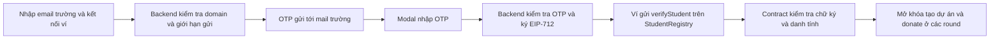

# SqrtFund

SqrtFund là công cụ minh bạch hóa phân bổ quỹ tài trợ cho dự án sinh viên bằng **Quadratic Funding (QF)** trên Avalanche Fuji. Bản hiện tại dùng Next.js 16, React, wagmi/viem, Solidity/Foundry/OpenZeppelin, Supabase và SMTP. Token demo là MockUSDC, không có giá trị thực.

**Email trường → OTP → ví Student dùng chung → tham gia các round.** StudentRegistry ràng buộc một email trường với một ví và một ví với một email. Xác thực một lần cho mọi round dùng chung registry; tạo dự án và donate đều kiểm tra quyền Student trực tiếp on-chain. Admin duyệt **dự án**, không cấp danh tính Student thủ công.

## Cơ chế QF và ngân sách

Sinh viên có thể ủng hộ nhiều dự án trong cùng round. Mỗi lần donate phải đạt `minDonation`; tổng donate của một ví vào một dự án không vượt `maxDonation`; tổng donate của ví vào mọi dự án trong round không vượt `maxPerRound`. Constructor bắt buộc `0 < minDonation <= maxDonation <= maxPerRound`. Ví dụ 1 / 5 / 10 USDC là cấu hình minh họa, không phải giới hạn cố định của mọi round.

`spentInRound(wallet)` cộng dồn các khoản donate, `remainingBudget(wallet)` trả phần còn lại. Mỗi round là một QFRound mới nên số đã chi tự bắt đầu từ 0, còn danh tính Student vẫn giữ nguyên. Chủ dự án không được tự donate vào dự án của mình; chỉ dự án đã được admin duyệt mới nhận donate.

Với dự án j và tổng đóng góp dᵢⱼ của từng ví i:

```text
raw[j] = max(0, (sum_i sqrt(d[i,j]))² - sum_i d[i,j])
base[j] = raw[j]                         nếu sum(raw) <= pool
        = floor(pool * raw[j]/sum(raw))  nếu sum(raw) > pool
matching[j] = min(base[j], floor(pool * maxMatchBps / 10000))
```

Nếu tổng raw bằng 0 thì matching bằng 0. Contract dùng số nguyên, `Math.sqrt` và `SCALE = 1e12`, có làm tròn xuống. Donate nhiều lần vào cùng dự án được **cộng dồn trước khi lấy căn**, nên chia nhỏ giao dịch không tạo thêm người ủng hộ. Matching không tự dùng hết pool khi tổng raw nhỏ hoặc chạm cap; phần dư được admin rút sau finalize. Chủ dự án claim tiền donate trực tiếp cộng matching sau finalize.

`MAX_PROJECTS = 50`. Finalize là **bounded O(N), N <= MAX_PROJECTS**, gồm tính matching và ghi payout cho các dự án được duyệt; không có bảo đảm “constant gas”. Admin được finalize từ lúc kết thúc; sau `FINALIZE_GRACE = 1 days`, bất kỳ ví nào cũng có thể finalize. Admin có thể nạp pool đến trước khi finalize, kể cả sau thời điểm đóng donate.

## Xác thực sinh viên



Backend chỉ ký attestation; **contract quyết định quyền**. Đúng OTP chưa hoàn tất xác thực on-chain: người dùng cần xác nhận giao dịch ví và đợi receipt thành công. UI refetch trạng thái để mở khóa ngay, không cần reload. `/verify` hoạt động khi chưa có factory hay round; `/register` và DonateBox chặn người chưa là Student, kể cả truy cập URL trực tiếp.

EIP-712 domain là `SqrtFundStudentRegistry`, version `1`, chain ID `43113`, verifyingContract là registry. Thông điệp gồm `student`, `emailHash`, `expiry`; chữ ký hiện có hạn 1 giờ. Contract buộc student là `msg.sender`, signer là attester, kiểm tra thời hạn và uniqueness hai chiều bằng `emailOwner`/`walletEmail`. Cùng ví và email gọi lại không đổi danh tính. Chỉ registry owner được đổi attester bằng `setAttester`.

Email được trim, lowercase và bỏ `+tag` trước khi hash để alias không tạo thêm danh tính; địa chỉ đầy đủ chỉ dùng để gửi thư. Khoảng trắng đầu/cuối được trim; khoảng trắng bên trong địa chỉ, thiếu/nhiều `@` và domain sai định dạng đều bị từ chối.

Policy email hỗ trợ nhiều trường mà không cần duy trì danh sách cố định:

- `ALLOWED_EMAIL_DOMAINS` **tùy chọn**. Không đặt hoặc để trống: chế độ `open-edu`, chấp nhận email hợp lệ có domain kết thúc bằng `.edu` hoặc `.edu.vn`, gồm subdomain như `student.hcmus.edu.vn`. Mặc định không chấp nhận `.ac.uk`.
- Có allowlist: chế độ `allowlist`, chỉ nhận domain được liệt kê và subdomain của chúng theo ranh giới dấu chấm. Danh sách phân tách dấu phẩy, trim khoảng trắng và không phân biệt hoa/thường. Ví dụ thêm `ox.ac.uk` để nhận trường đó; khi đã có allowlist thì domain `.edu` khác không tự được nhận.
- `BLOCKED_EMAIL_DOMAINS` **tùy chọn**, mặc định trống. Domain bị chặn và mọi subdomain của nó bị từ chối trong cả hai chế độ, kể cả khi cũng xuất hiện trong allowlist.

Các địa chỉ `a@b.edu.vn.evil.com`, `a@evil.com`, `a@edu.vn`, `a@.edu.vn` không được chấp nhận ở chế độ mặc định. Bare domain `edu.vn` bị từ chối cả khi khai báo trong allowlist. Ví dụ chặn `fake.edu.vn` cũng chặn `student.fake.edu.vn`, không chặn `notfake.edu.vn`.

`GET /api/verify/request-otp` công khai chỉ trả policy domain, ví dụ `{ "mode": "open-edu", "allowedDomains": [], "blockedDomains": [] }`. UI dùng cùng policy với server, hiện “Dùng email trường (.edu / .edu.vn)” ở chế độ mở hoặc danh sách domain ở chế độ allowlist; không trả key hay secret. Bỏ trống hai biến domain không gây `CONFIG_MISSING`.


Nếu DB đã xác nhận cùng email/ví nhưng giao dịch ví chưa hoàn thành, request trả `ALREADY_VERIFIED` cùng proof mới, không gửi thêm email. UI chuyển sang giao dịch `verifyStudent`. `isWhitelisted` trên QFRound chỉ còn là view tương thích đọc `StudentRegistry.isStudent`, không có danh sách quyền độc lập.

## Chống Sybil và spam: ba lớp

| Lớp | Biện pháp trong code |
| --- | --- |
| Backend | Policy open-edu/allowlist và blocklist; chuẩn hóa alias; OTP ngẫu nhiên 6 chữ số, băm HMAC gắn request; OTP hết hạn sau 10 phút, dùng một lần; tối đa 5 lần nhập sai; gọi RPC rate limit trong DB; không log email thô, OTP, secret |
| Database | `unique(email_hash)` và `unique(address)`; RLS bật, không policy cho client; REVOKE public/anon/authenticated; chỉ service role được truy cập bảng và RPC; row lock khi consume; advisory lock theo thứ tự cố định khi reserve |
| Contract | `isStudent` từ registry; chữ ký EIP-712 gắn ví/chain/registry và expiry; một email một ví, một ví một email; trần mỗi dự án và tổng mỗi round; chặn tự donate; CEI, nonReentrant, SafeERC20 |

Rate limit được kiểm tra và ghi trong cùng transaction: cooldown 60 giây theo cặp email/ví; 3 lần/10 phút theo email; 10 lần/10 phút theo IP; 5 lần/giờ theo ví. Mã gửi lại làm OTP trước của cùng cặp mất hiệu lực. Chống Sybil này giới hạn theo email trường, chưa chứng minh một con người duy nhất.

## Kiến trúc và thư mục

| Contract | Vai trò |
| --- | --- |
| `contracts/src/StudentRegistry.sol` | Danh tính Student toàn cục, EIP-712, attester, uniqueness email/ví |
| `contracts/src/RoundFactory.sol` | Owner tạo QFRound, truyền registry dùng chung và `maxPerRound` |
| `contracts/src/QFRound.sol` | Đăng ký/duyệt dự án, donate, ngân sách, matching cap, finalize, claim |
| `contracts/src/MockUSDC.sol` | ERC-20 demo 6 decimals; faucet 100 token/lần, cooldown 1 giờ, lifetime cap 1.000 token/ví; owner mint cho demo |

| Đường dẫn | Nội dung |
| --- | --- |
| `src/app/api/verify/request-otp/route.ts` | GET chế độ/policy domain công khai; POST validate registry, reserve OTP, gửi mail hoặc tiếp tục danh tính đã xác nhận |
| `src/app/api/verify/confirm/route.ts` | POST consume OTP, ký attestation, ghi binding trước khi trả proof |
| `src/app/api/verify/stats/route.ts` | GET thống kê binding email đã xác nhận trong DB, không phải số giao dịch registry đã mined |
| `src/lib/verify/` | Config, domain, HMAC, signer, rate limit, Supabase admin, SMTP/template và lỗi an toàn |
| `src/components/verify/` | Form email, modal OTP, gate Student, thống kê |
| `src/hooks/useStudentStatus.ts` | Đọc Student trực tiếp từ registry |
| `src/lib/contracts/roundReads.ts` | Probe phiên bản, multicall cho phép lỗi từng trường, bỏ getter mới trên round cũ |
| `src/lib/contracts/rpc.ts` | HTTP batch, retry/backoff và RPC fallback tùy chọn |
| `src/components/project/DonateBox.tsx` | Quyền donate, giới hạn dự án và ngân sách còn lại |
| `src/components/admin/CreateRoundForm.tsx` | Cấu hình round, gồm `maxPerRound` |
| `supabase/migrations/0001_verification.sql` | Migration duy nhất: hai bảng, RPC, RLS/quyền và khối SQL reset dưới dạng comment |
| `contracts/test/`, `__tests__/` | Foundry và Vitest |
| `scripts/sync-abis.mjs` | Sinh ABI cho cả bốn contract |
| `scripts/test-mail.ts` | Gọi trực tiếp mailer thật, không ghi Supabase |
| `docs/redeploy-fuji.md` | Thứ tự deploy, cập nhật manifest/env, cast và curl |
| `docs/round-loading-fuji.md` | Chẩn đoán /round, bảng cast, factory hiện có và lệnh keystore deployer |
| `docs/change-report.md` | Danh sách tệp đổi/xóa, từng mục README và công việc cần tự hoàn tất |

## Deployment Fuji hiện có

Đọc từ `contracts/deployments/fuji.json`; chain ID 43113. Các địa chỉ dưới đây đã được đối chiếu getter bằng RPC Fuji ngày 17/10/2026. Factory mới hiện trả `getRounds()=[]`, cần admin tạo round đầu tiên. Không có deployment hay giao dịch ghi chain do agent thực hiện trong lần sửa này.

| Contract | Địa chỉ trong manifest | Explorer |
| --- | --- | --- |
| StudentRegistry | `0xbA0b756Ac2830743Cc56Fb42E504ED4d374Fe58e` | [StudentRegistry trên Snowtrace](https://testnet.snowtrace.io/address/0xbA0b756Ac2830743Cc56Fb42E504ED4d374Fe58e) |
| RoundFactory | `0x4fb01ae390bD9F46Dd921e5aC5D99c17912074D8` | [RoundFactory trên Snowtrace](https://testnet.snowtrace.io/address/0x4fb01ae390bD9F46Dd921e5aC5D99c17912074D8) |
| MockUSDC | `0x38efb1BA71C7CDB8Dd44e860A0A5cADE864d3205` | [MockUSDC trên Snowtrace](https://testnet.snowtrace.io/address/0x38efb1BA71C7CDB8Dd44e860A0A5cADE864d3205) |

Factory mới trả registry đúng địa chỉ trên và có selector `createRound` với `maxPerRound`; registry trả attester `0x5C2001c91aEFFaEDf9ef438cA50Bcddd23ce6181`. Chưa tạo round thử trên factory này. Factory cũ `0x77015FBa44D3885C25E421f59Ae5C3a5bA87AF4A` chứa round có getter `maxPerRound`/`studentRegistry` revert và chỉ dùng xem lịch sử với nhãn “Round phiên bản cũ”. Không thể cập nhật bytecode cũ bằng đổi ABI.

Nếu `/round` còn trỏ factory cũ, ưu tiên [hướng dẫn chẩn đoán và chuyển sang factory đã có](docs/round-loading-fuji.md): đổi public env local/Vercel sang factory trong manifest, restart/redeploy, tạo round mới. Tài liệu có bảng từng lệnh cast, lệnh keystore `deployer` để tự deploy factory khác nếu cần, và bước mint/depositPool/duyệt dự án. Redeploy Vercel bỏ tick dùng Build Cache.

[Hướng dẫn deploy tổng quát](docs/redeploy-fuji.md) dành cho môi trường chưa có deployment phù hợp. `DeployStudentRegistry.s.sol` cần `ATTESTER_ADDRESS`; `DeployFactory.s.sol` constructor chỉ truyền registry từ `STUDENT_REGISTRY_ADDRESS`, đọc token từ manifest để giữ địa chỉ, không deploy lại token. `Deploy.s.sol` tạo mới cả token, registry và factory, chỉ dùng khi muốn cài mới hoàn toàn.

## Cài đặt và cấu hình

Cần Node.js 22+ hỗ trợ TypeScript stripping (đã kiểm tra bằng Node 24), pnpm theo `package.json`, Foundry và các thư viện trong `contracts/lib/`.

```bash
pnpm install
cp .env.example .env.local
forge test --root contracts
pnpm abi
```

Điền placeholder trong `.env.local` trên máy của bạn, không commit. Mỗi biến một dòng, không khoảng trắng quanh dấu `=`. Các giá trị mạng có sẵn trong `.env.example` là cấu hình công khai; các ô trống phải được điền theo môi trường. Dừng và restart `pnpm dev` sau khi đổi env; public env trên Vercel cần build/redeploy mới.

| Biến (khớp `.env.example`) | Mô tả | Phạm vi |
| --- | --- | --- |
| `NEXT_PUBLIC_CHAIN_ID` | Fuji: 43113, giữ thống nhất với chain xác thực | Công khai |
| `NEXT_PUBLIC_RPC_URL` | Fuji C-Chain RPC; không đặt credential bí mật trong URL công khai | Công khai |
| `NEXT_PUBLIC_RPC_URL_FALLBACK` | Tùy chọn: RPC Fuji thứ hai, dùng khi RPC chính lỗi; trống = chỉ dùng RPC chính | Công khai |
| `NEXT_PUBLIC_EXPLORER_URL` | Explorer giao dịch/địa chỉ Fuji | Công khai |
| `NEXT_PUBLIC_STUDENT_REGISTRY_ADDRESS` | Registry mới đã deploy, bắt buộc cho OTP | Công khai |
| `NEXT_PUBLIC_FACTORY_ADDRESS` | Factory mới dùng registry chung | Công khai |
| `NEXT_PUBLIC_USDC_ADDRESS` | MockUSDC đang dùng | Công khai |
| `ATTESTER_PRIVATE_KEY` | Khóa 0x của ví attester riêng, khác deployer/admin | **Bí mật, chỉ server** |
| `OTP_SECRET` | Secret ngẫu nhiên tối thiểu 32 ký tự để HMAC OTP/IP | **Bí mật, chỉ server** |
| `SUPABASE_URL` | URL project, server dùng qua admin client | Server, không prefix public |
| `SUPABASE_SERVICE_ROLE_KEY` | Service role key của project | **Bí mật, chỉ server** |
| `EMAIL_PROVIDER` | `smtp` hoặc `resend` | Server, cấu hình |
| `SMTP_HOST` | Gmail: smtp.gmail.com | Server, cấu hình |
| `SMTP_PORT` | Gmail STARTTLS: 587; 465 dùng TLS trực tiếp | Server, cấu hình |
| `SMTP_USER` | Hộp thư gửi; Gmail phải khớp địa chỉ From | Server, thông tin tài khoản |
| `SMTP_PASS` | Gmail App Password 16 ký tự viết liền | **Bí mật, chỉ server** |
| `SMTP_FROM` | Ví dụ `SqrtFund <your-sender@gmail.com>`, thay bằng sender của bạn | Server, cấu hình |
| `ALLOWED_EMAIL_DOMAINS` | Tùy chọn; trống = mọi `.edu`/`.edu.vn`; có giá trị = chỉ danh sách và subdomain | Server, cấu hình; policy được GET công khai |
| `BLOCKED_EMAIL_DOMAINS` | Tùy chọn, mặc định trống; chặn danh sách domain và subdomain, ưu tiên hơn allowlist | Server, cấu hình; policy được GET công khai |
| `RESEND_API_KEY` | Chỉ bắt buộc khi provider là resend, From cần domain đã xác minh | **Bí mật, chỉ server** |
| `ATTESTER_ADDRESS` | Địa chỉ công khai suy ra từ ví attester, dùng deploy registry | Công khai, env deploy |
| `RUN_VERIFICATION_INTEGRATION` | Mặc định 0; chỉ bật 1 cho project DEV riêng | Test, cấu hình |
| `SUPABASE_TEST_URL` | URL project DEV riêng cho integration test | Test, không prefix public |
| `SUPABASE_TEST_SERVICE_ROLE_KEY` | Service role key project DEV, không tái dùng production | **Bí mật, chỉ test server** |
| `STUDENT_REGISTRY_ADDRESS` | Registry đã deploy để DeployFactory tái sử dụng | Công khai, env deploy |

### Supabase

1. Tạo project. Trong SQL Editor của project rỗng được chọn, lấy khối `MANUAL RESET` cuối `supabase/migrations/0001_verification.sql`, bỏ comment và chạy **riêng trước**. Đây là thao tác xóa bảng; chỉ chạy trên project đã xác nhận không còn dữ liệu cần giữ.
2. Chạy toàn bộ `supabase/migrations/0001_verification.sql`, không cần migration bổ sung. Hai bảng là `otp_requests`, `verifications`; không mở RLS policy cho browser.
3. Lấy Project URL và service role key vào hai biến `SUPABASE_URL`, `SUPABASE_SERVICE_ROLE_KEY`. Không prefix `NEXT_PUBLIC_`, không dùng anon key thay service role key.
4. Để trống `ALLOWED_EMAIL_DOMAINS` cho chế độ mở `.edu`/`.edu.vn`, hoặc điền danh sách để giới hạn trường. Có thể thêm `BLOCKED_EMAIL_DOMAINS` để chặn domain không phù hợp. Cấu hình registry và signer khớp on-chain trước khi thử gửi mã.

### Gmail SMTP và kiểm tra mail

Bật 2FA rồi tạo [Google App Password](https://support.google.com/accounts/answer/185833?hl=en). Đặt 16 ký tự **viết liền, không dấu cách** vào `SMTP_PASS`; tài khoản tổ chức có thể không cho tạo App Password. `SMTP_FROM` phải có cùng địa chỉ với `SMTP_USER`. Port 587 dùng `secure=false`, `requireTLS=true`; mailer có connection timeout 10 giây và socket timeout 15 giây, không nuốt lỗi SMTP.

Restart dev server sau khi sửa env. Kiểm tra chính mailer API sử dụng, với hộp thư bạn kiểm soát:

```bash
node --conditions=react-server --env-file=.env.local --experimental-strip-types scripts/test-mail.ts student@your-school.edu.vn
pnpm dev
```

Thay email mẫu trước khi chạy. Script gửi mail thật, không ghi DB; mã mail test không dùng để xác thực tài khoản. Nó chỉ log provider đã chấp nhận hoặc diagnostic an toàn; cần tự kiểm tra Inbox/Spam để xác nhận đã nhận. Email có bản text và HTML tông đỏ/đen với gradient, xem `docs/previews/student-verification.html`.

Dùng ví attester riêng cho backend. `attesterAccount()` trong signer suy ra account từ `ATTESTER_PRIVATE_KEY`; cách lấy **chỉ địa chỉ công khai** và kiểm tra `attester()` được ghi trong `docs/redeploy-fuji.md`. Registry owner có thể xoay attester; đổi khóa backend đồng bộ, Student đã xác thực giữ nguyên.

### Vercel

Import repository, dùng pnpm và build `pnpm build`. Thêm các env cần thiết vào đúng Production/Preview environment. Đánh dấu **Sensitive** cho khóa attester, OTP secret, SMTP password, service role key và Resend key nếu dùng; không gửi chúng qua `NEXT_PUBLIC_*`. Địa chỉ contract là public. Redeploy sau khi đổi env để public address được build lại. Không bật test integration với production database.

### API và lỗi vận hành

| API | Input / kết quả |
| --- | --- |
| `GET /api/verify/request-otp` | `{mode,allowedDomains,blockedDomains}`; mode là `open-edu` hoặc `allowlist`, không yêu cầu env domain |
| `POST /api/verify/request-otp` | `{email,address}` → requestId, expiresAt, resendAfter; hoặc `ALREADY_VERIFIED` + proof |
| `POST /api/verify/confirm` | `{requestId,otp}` → registryAddress, chainId, emailHash, expiry, signature |
| `GET /api/verify/stats` | Tổng binding DB và thống kê domain, không lộ email thô |

Mẫu curl với placeholder (thay bằng dữ liệu bạn kiểm soát):

```bash
curl -sS http://localhost:3000/api/verify/request-otp \
  -H 'Content-Type: application/json' \
  -d '{"email":"student@your-school.edu.vn","address":"0xYOUR_STUDENT_WALLET"}'
curl -sS http://localhost:3000/api/verify/confirm \
  -H 'Content-Type: application/json' \
  -d '{"requestId":"UUID_FROM_REQUEST","otp":"SIX_DIGITS_FROM_EMAIL"}'
```

Các mã phân biệt: `CONFIG_MISSING` (503, chỉ kèm tên biến thiếu/sai), `DB_SCHEMA_MISMATCH` (503), `REGISTRY_UNAVAILABLE` (503, RPC/getter/attester), `EMAIL_SEND_FAILED` (502), `SERVICE_UNAVAILABLE` (503). Domain sai trả `INVALID_DOMAIN`; email/ví đã gắn danh tính khác trả `EMAIL_ALREADY_USED`/`WALLET_ALREADY_VERIFIED`; `RATE_LIMITED` trả 429 và Retry-After. OTP sai/hết hạn/khóa có mã riêng; UI dùng toast EN/VI và countdown gửi lại.

Server log chỉ gồm stage `validate|registry|rateLimit|insert|mail`, name, code, message được rút gọn/lọc dữ liệu nhạy cảm. Registry được kiểm tra **trước khi gọi mailer**: lỗi địa chỉ/attester ngăn gửi mail ngay, không đủ bằng chứng để kết luận SMTP sai. Registry/factory mới đã có trong manifest và getter đã được kiểm tra; cần đồng bộ public env rồi tự kiểm tra toàn luồng bằng ví/mail thật.

## Kiểm thử đã chạy

Kết quả cục bộ ngày 17/10/2026, theo code hiện tại:

| Lệnh / kiểm tra | Kết quả |
| --- | --- |
| `pnpm exec tsc --noEmit` | Pass |
| `pnpm lint` | Pass |
| `RUN_VERIFICATION_INTEGRATION=0 pnpm test` | **204 passed, 13 skipped**; 25 file pass, 2 file integration skip |
| `forge test --root contracts` | **67 passed, 0 failed** |
| `pnpm build` | Pass; còn warning dependency động từ ox/viem, không làm build thất bại |
| `pnpm abi` | Đã đồng bộ ABI bốn contract |
| Migration trên Postgres WASM cục bộ | Pass: schema sạch, đủ 5 trạng thái reserve, OTP một lần/khóa 5 sai, unique hai chiều, RLS/REVOKE |
| Script mail không truyền recipient | Import code thật thành công, trả usage/exit 1 đúng dự kiến, không gửi mail |
| RPC Fuji chỉ đọc | Đối chiếu từng getter round/factory cũ, registry/factory mới; test loader multicall qua transport mới chạy riêng **1 pass** |

Foundry bao phủ danh tính dùng chung qua hai round, quyền on-chain, expiry/signer/sender/chain/registry, uniqueness và replay idempotent; ngân sách chia 5 USDC cho 5 dự án, đúng trần/vượt 1 đơn vị nhỏ nhất, reset round mới, fuzz `spentInRound <= maxPerRound` và tổng matching payout `<= pool`. Vitest bao phủ API, HMAC/domain/alias, chế độ domain mở/allowlist/blocklist và chống giả mạo domain, cấu hình và lỗi SMTP, EIP-712, role/gate/budget, phân lập lỗi round và nhãn legacy, HTTP batch/fallback/backoff, parity bản dịch và các test sẵn có.

Bộ mặc định skip có chủ đích 12 test Supabase thật và 1 test RPC Fuji opt-in. Test Fuji chỉ đọc đã được chạy riêng thành công bằng `RUN_ROUND_RPC_INTEGRATION=1 pnpm vitest run __tests__/round-rpc.integration.test.ts`. 12 test Supabase chưa chạy vì chưa dùng project DEV riêng. Chỉ bật khi bạn cho phép ghi dữ liệu test vào project DEV đã chạy migration:

```bash
RUN_VERIFICATION_INTEGRATION=1 pnpm vitest run __tests__/email-otp.integration.test.ts
```

Cần tự cung cấp `SUPABASE_TEST_URL` và `SUPABASE_TEST_SERVICE_ROLE_KEY` trong môi trường chạy test. Chưa kiểm chứng SMTP tới mail trường thật, migration Supabase thật hay giao dịch tạo round/donate mới. Deployment mới hiện có được kiểm tra chỉ đọc; agent không tự deploy.

**Gas: chưa đo lại bảng gas từng hàm. Finalize với 50 dự án: chưa đo với 50 dự án.** Số gas hiển thị cho một hàm test Foundry không được coi là benchmark riêng của finalize.

## Pitch

**Why on-chain?** Quy tắc quyền Student, ngân sách, matching, claim và lịch sử giao dịch kiểm chứng được độc lập; quỹ nằm trong contract và thanh toán theo kết quả finalize. Email/OTP vẫn xử lý off-chain; chữ ký backend không tự chuyển tiền hay cấp quyền nếu contract không chấp nhận.

**Why Avalanche?** C-Chain tương thích EVM, dùng được Solidity/OpenZeppelin/Foundry và ví hiện có; Fuji cung cấp môi trường thử nghiệm trước khi dùng tiền thật. Không khẳng định TPS, phí hay độ trễ chưa đo trong dự án. Xem [tài liệu mạng Avalanche](https://docs.avax.network/docs/primary-network).

**Tiền đến từ đâu?** Nhà tài trợ/CLB cấp matching pool thông qua admin `depositPool`; sinh viên đóng góp trực tiếp vào dự án. Demo dùng token MockUSDC từ faucet hoặc owner mint; QF là cách phân bổ pool có sẵn, không tự tạo tiền. Chủ dự án nhận direct donations + matching; admin chỉ rút phần pool chưa phân bổ sau finalize.

## Bonus đã làm

- Matching cap theo dự án bằng `maxMatchBps`, giới hạn tỷ lệ pool cho một dự án.
- Danh tính email trường bằng **backend attestation** và registry toàn cục; chưa phải ZK email.
- Ngân sách riêng mỗi sinh viên mỗi round và preview matching dùng cùng quy tắc tính như finalize.

## Known Limitations

- Chế độ mở chỉ kiểm tra đuôi tên miền `.edu`/`.edu.vn`, không xác minh cơ quan cấp mail có phải trường hay không. OTP chứng minh quyền truy cập hộp thư; quản trị viên có thể thêm blocklist hoặc dùng allowlist để giới hạn theo chính sách.

- Attester là điểm tin cậy tập trung; backend bị chiếm quyền ký có thể cấp danh tính sai.
- Một người có nhiều email trường vẫn có thể xác thực nhiều ví; bỏ `+tag` không giải quyết được trường hợp này.
- Trần ngân sách giảm, chưa loại bỏ ảnh hưởng của người giàu.
- Chưa chống collusion; pairwise matching là hướng mở rộng, chưa triển khai.
- Admin duyệt dự án nên vẫn có kiểm duyệt.
- Pool nạp được đến trước finalize, do đó matching dự kiến có thể thay đổi.
- Supabase/SMTP là phụ thuộc bên thứ ba; Gmail có [giới hạn gửi mail theo ngày](https://support.google.com/mail/answer/22839?hl=en-GB), quota/chính sách phụ thuộc loại tài khoản.
- Contract chưa audit. Lộ trình gồm audit, ZK email và tích hợp Gitcoin Passport; các mục này chưa được triển khai.

## Pháp lý Việt Nam

Đây là bản thử nghiệm **testnet**; MockUSDC không có giá trị. Mục đích là công cụ minh bạch hóa phân bổ quỹ tài trợ, không phải gọi vốn hay đầu tư, không hứa hẹn lợi nhuận. Trước khi vận hành với tài sản thật cần đối chiếu văn bản pháp luật hiện hành về tài sản số và các nghĩa vụ liên quan theo mô hình triển khai cụ thể. Nguồn đối chiếu: [Luật Công nghiệp công nghệ số số 71/2025/QH15 trên Công báo Chính phủ](https://congbao.chinhphu.vn/van-ban/luat-so-71-2025-qh15-45555.htm), có hiệu lực từ 01/01/2026; việc dẫn nguồn không có nghĩa hệ thống đã được xác nhận tuân thủ pháp luật.

## Liên kết mạng để tự kiểm tra

- [Snowtrace Fuji](https://testnet.snowtrace.io/).
- [Factory mới trên Snowtrace](https://testnet.snowtrace.io/address/0x4fb01ae390bD9F46Dd921e5aC5D99c17912074D8).
- [StudentRegistry trên Snowtrace](https://testnet.snowtrace.io/address/0xbA0b756Ac2830743Cc56Fb42E504ED4d374Fe58e).
- [Factory cũ trên Snowtrace](https://testnet.snowtrace.io/address/0x77015FBa44D3885C25E421f59Ae5C3a5bA87AF4A).
- [MockUSDC hiện có trên Snowtrace](https://testnet.snowtrace.io/address/0x38efb1BA71C7CDB8Dd44e860A0A5cADE864d3205).
- [Core Fuji AVAX faucet](https://core.app/tools/testnet-faucet/); cần làm theo [điều kiện faucet của Avalanche](https://support.avax.network/en/articles/6110239-is-there-an-avax-faucet).
- [Avalanche Fuji explorer chính thức](https://explorer-test.avax.network/c-chain).

MockUSDC của ứng dụng dùng `faucetMint` tại trang `/my`; token lấy từ faucet USDC bên ngoài không tự thay thế token của round. Các link được liệt kê để bạn bấm kiểm tra; điều kiện faucet và giao diện explorer có thể thay đổi. Link registry/factory mới lấy từ manifest và được liệt kê ở trên; hãy dùng đúng các địa chỉ public này cho môi trường đang chạy.
