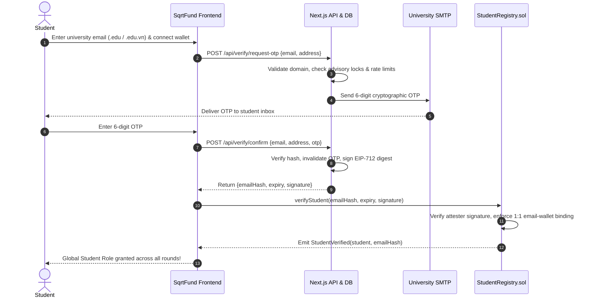
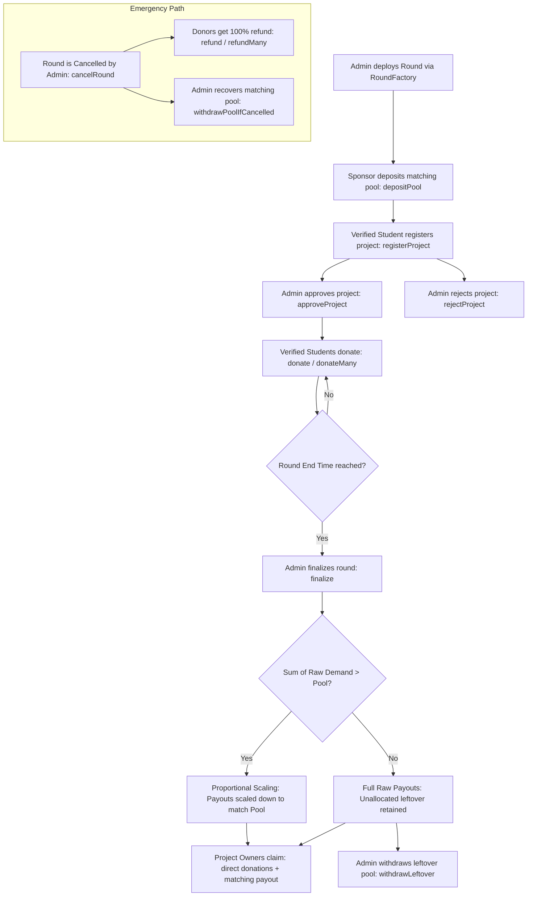

# SqrtFund — Democratic Quadratic Funding for Student Initiatives

> **Topic 6: Avalanche Hackathon (Team1 Vietnam)**<br>
> **Network:** Avalanche Fuji Testnet (Chain ID: `43113`)<br>
> **Live Web Application:** [https://sqrt-fund.vercel.app](https://sqrt-fund.vercel.app)<br>
> **Demo Video:** `[Điền link YouTube/Loom demo video tại đây]`<br>
> **Pitch Deck / Slides:** `[Điền link Google Slides / PDF pitch deck tại đây]`<br>

---

Đo hiệu năng và SEO local: xem [báo cáo trước/sau, giới hạn phép đo, robots/sitemap và lệnh kiểm tra](docs/PERFORMANCE_SEO.md). Cấu hình domain canonical bằng `NEXT_PUBLIC_SITE_URL` trước khi tự redeploy; báo cáo local không phải kết quả trên Vercel.

## Evaluation Criteria Self-Assessment

Vòng online chấm Technical Implementation và Avalanche Integration (50 điểm). Xem [bảng Strong / Partial / Missing, evidence theo từng tiêu chí và roadmap](docs/EVALUATION.md). Bằng chứng ngày 17/10/2026: local tests pass; factory Fuji trong manifest chưa có round, factory/token chưa khớp artifact local; demo live và phí AVAX từ receipt còn thiếu.

## Tóm tắt dự án (Executive Summary - Tiếng Việt)

**SqrtFund** là nền tảng tài trợ cộng đồng ứng dụng cơ chế **Quadratic Funding (QF)** trên mạng **Avalanche Fuji**, được thiết kế chuyên biệt cho các câu lạc bộ (CLB) và dự án nghiên cứu sinh viên tại Việt Nam.

* **Vấn đề thực tế:** Quỹ hoạt động sinh viên tại các trường đại học thường được phân bổ theo cơ chế hành chính tập quyền, quan hệ cá nhân hoặc bình chọn cảm tính, thiếu tính minh bạch và chưa phản ánh đúng nhu cầu thực tế của số đông sinh viên.
* **Giải pháp của SqrtFund:** Kết hợp xác thực danh tính sinh viên qua email trường (`.edu`, `.edu.vn`) với cơ chế Quadratic Funding trên hợp đồng thông minh. Tại đây, **số lượng người ủng hộ tạo ra sức mạnh đòn bẩy lớn hơn quy mô tiền của cá voi**: 100 ví góp 1 MockUSDC tạo matching thô khoảng **5.21 lần** so với 20 ví góp 5 MockUSDC, cùng tổng góp 100; payout thực còn phụ thuộc pool và cap (xem [số tính bằng code](docs/EVALUATION.md#presentation-pitching)).
* **Đặc tính kỹ thuật cốt lõi:**
  1. **Toàn bộ phép toán QF chạy on-chain** bằng số nguyên với độ chính xác `SCALE = 1e12`, hỗ trợ scaling tỷ lệ khi quỹ thiếu hụt và áp dụng trần tài trợ cho từng dự án (`maxMatchBps`).
  2. **Hệ thống xác thực sinh viên tập trung (StudentRegistry)**: Xác thực một lần duy nhất qua email trường + OTP + chữ ký số EIP-712, dùng chung cho mọi vòng gọi vốn mà không cần cấp lại quyền.
  3. **Tối ưu hóa phí trên Avalanche**: Hỗ trợ quyên góp theo lô (`donateMany`) giúp sinh viên phân bổ ngân sách cho nhiều dự án trong **1 giao dịch duy nhất**; cần approve riêng nếu thiếu allowance. Chưa đo mức tiết kiệm bằng receipt Fuji.
  4. **Cơ chế an toàn toàn diện (Giai đoạn 2)**: Tích hợp hủy vòng khẩn cấp (`cancelRound`) và cho phép người góp tự gọi giao dịch hoàn tiền gốc 100% (`refund` / `refundMany`) đã được kiểm chứng bằng 128.000 lượt kiểm thử bất biến (Invariant testing).

---

## 1. What It Does

### The Problem
University student clubs, hackathon teams, and grassroots research groups struggle to secure funding. Traditional grant allocation suffers from:
- **Centralized Gatekeeping:** University grant boards or corporate sponsors distribute funds based on pitch polish, seniority, or administrative connections rather than grassroots utility.
- **Plutocratic Bias:** In standard crowdfunding, a few wealthy donors dominate the outcome, sidelining everyday student voices.
- **Opaque Accounting:** Funds disappear into private bank accounts with zero verifiable milestones, real-time tracking, or accountability.

### The Solution: Quadratic Funding (QF)
SqrtFund implements **Quadratic Funding** as formulated by Vitalik Buterin, Zoë Hitzig, and E. Glen Weyl. Individual contributions are matched by a central subsidy pool provided by universities or alumni sponsors.

The mathematical matching formula rewards **breadth of consensus over capital volume**:
$$\text{Matching Pool Share} \propto \left(\sum_{i=1}^{N} \sqrt{d_i}\right)^2 - \sum_{i=1}^{N} d_i$$

Where $d_i$ is the micro-donation from verified student $i$. Projects loved by hundreds of students receive exponentially higher matching subsidies than projects financed by a single deep-pocketed donor.

### User Personas
| Persona | Responsibilities & Capabilities |
| :--- | :--- |
| **Verified Student** | Verifies university email once; receives global student role; donates 1–5 USDC individually or via batch allocation across projects within round budget limits. |
| **Club / Project Lead** | Must be a verified student; submits project proposals (title, description, links, banner); tracks real-time expected matching; claims principal + matching upon finalization. |
| **Round Sponsor / Admin** | Deploys round via `RoundFactory`; deposits matching pool; approves or rejects student projects on-chain; monitors health; triggers emergency cancellation & pool withdrawal if compromised. |

### Features Implemented in Current Source

Deployment status is assessed separately in [Evaluation](docs/EVALUATION.md#avalanche-integration); source implementation does not establish a working Fuji round.
- [x] **Universal Student Attestation:** One-time verification via university email OTP + EIP-712 attestation.
- [x] **Multi-Round Factory Architecture:** Deploy independent funding rounds with custom timelines, budgets, and matching caps.
- [x] **Project Registration & Admin Curation:** Verified students register projects; the round admin approves or permanently rejects proposals on-chain (`approveProject` / `rejectProject`).
- [x] **Single & Batch Donations (`donateMany`):** Atomic multi-project donation in a single ERC20 transfer.
- [x] **Deterministic Real-Time QF Engine:** On-chain integer math with `SCALE = 1e12` and real-time frontend simulation.
- [x] **Proportional Underfunding Scaling:** Automatically scales subsidies if total raw demand exceeds matching pool.
- [x] **Emergency Cancellation & 100% Donor Refunds:** Non-reentrant multi-project refunding if a round is canceled.
- [x] **Two-Tier Finalization:** Admin finalization during 24h grace period; permissionless public finalization afterwards.
- [x] **Direct Escrow Claims:** Project owners directly claim aggregated principal + matching payouts.

---

## 2. Topic 6 Requirement Compliance Matrix

| Requirement / Bonus Track | Status | Implementation Evidence | Verification File / Test |
| :--- | :---: | :--- | :--- |
| **MVP 1: Round Creation & Pool Deposit** | **Done** | `RoundFactory.sol`, `QFRound.sol::depositPool` | `contracts/test/QFRound.t.sol` (`test_DepositPool_ZeroAmountReverts`) |
| **MVP 1: Project Registration** | **Done** | `QFRound.sol::registerProject` (max 50 projects, max 2/owner) | `contracts/test/QFRound.t.sol` (`test_RegisterProject_LengthLimits`) |
| **MVP 2: Student Attestation** | **Done** | Email OTP + EIP-712 attestation backend + `StudentRegistry.sol` | `contracts/test/StudentVerification.t.sol` (40 tests passed) |
| **MVP 2: Donation Mechanism** | **Done** | `QFRound.sol::donate` with min/max bounds and round budget | `contracts/test/QFRound.t.sol` (`test_DonationLimits_PerProject_And_MultipleProjects`) |
| **MVP 2: On-chain QF Calculation** | **Done** | `QFRound.sol::_computeMatching` with integer square root | `contracts/test/QFRound.t.sol` (`test_Math_300x1_beats_60x5`) |
| **MVP 2: Finalize & Distribution** | **Done** | `QFRound.sol::finalize` & `claim` with bounded $O(N)$ execution | `contracts/test/QFRound.t.sol` (`test_ClaimFlow`) |
| **MVP 3: Real-Time Dashboard** | **Done** | Live supporters, total donated, expected matching preview | `src/views/round-detail.tsx`, `src/components/leaderboard/Leaderboard.tsx` |
| **Bonus 1: Per-Project Matching Cap** | **Done** | `maxMatchBps` parameter caps individual project subsidy | `contracts/test/QFRound.t.sol` (`test_MatchingCapEnforced`) |
| **Bonus 2: University Email Attestation** | **Done** | Enforced `.edu`, `.edu.vn` validation with rate limits & OTP | `src/lib/verify/domain.ts`, `__tests__/email-otp.test.ts` (see current test log in the evaluation) |
| **Bonus 3: Multi-Pool Architecture** | **Done** | `RoundFactory.sol` creates isolated `QFRound` pools on 1 registry | `contracts/test/QFRound.t.sol` (`test_RoundFactory_OnlyOwnerAndRoundCountWithSeveralRounds`) |
| **Bonus 4: Pairwise Matching (COI)** | *Roadmap* | Standard QF implemented; Pairwise coordination penalty planned | *See Section 12 (Known Limitations & Roadmap)* |

> [!NOTE]
> **Honest Architecture Clarification:** SqrtFund's student attestation uses **University Email OTP + Backend Attester EIP-712 Signature Verification**. It is **not** client-side Zero-Knowledge Email (ZK-Email). The smart contract independently validates the EIP-712 typed signature, expiration timestamp, and 1:1 wallet-email uniqueness binding.

---

## 3. System Architecture & Data Flows

### Component Breakdown
```
                                +--------------------------------------------+
                                |               Next.js 16 UI                |
                                |   (Tailwind, Wagmi v2, Viem, TanStack)    |
                                +---------------------+----------------------+
                                                      |
                    +---------------------------------+--------------------------------+
                    |                                                                  |
         (EIP-712 Verification)                                              (Contract Calls / RPC)
                    |                                                                  |
                    v                                                                  v
   +---------------------------------+                                +---------------------------------+
   |      Next.js API & Supabase     |                                |     Avalanche Fuji C-Chain      |
   | - OTP Generation & Rate Limit   |                                | - StudentRegistry.sol           |
   | - SMTP Mailer (.edu/.edu.vn)    |                                | - RoundFactory.sol              |
   | - EIP-712 Private Signer        |                                | - QFRound.sol (Instances)       |
   | - PostgreSQL (Audit logs)       |                                | - MockUSDC.sol (ERC20 Test)     |
   +---------------------------------+                                +---------------------------------+
```

### 1. Student Verification Flow (Attestation)


### 2. Fund & Allocation Lifecycle Flow


---

## 4. Quadratic Funding Mechanism & Mathematics

### The Mathematical Model
For any round with approved projects $j \in \{1, \dots, M\}$ and individual contributions $d_{i,j}$ from verified students $i$:

1. **Sum of Roots:**
   $$S_j = \sum_{i} \sqrt{d_{i,j}}$$
2. **Raw Subsidy Demand:**
   $$raw_j = \max\left(0, \frac{S_j^2}{\text{SCALE}} - \sum_i d_{i,j}\right)$$
3. **Proportional Allocation (Underfunded Protection):**
   If $\sum_j raw_j > \text{Pool}$, subsidies are scaled proportionally:
   $$base_j = \left\lfloor \frac{\text{Pool} \times raw_j}{\sum_j raw_j} \right\rfloor$$
   If $\sum_j raw_j \le \text{Pool}$, each project receives its full raw subsidy: $base_j = raw_j$.
4. **Per-Project Matching Cap:**
   $$\text{cap} = \left\lfloor \frac{\text{Pool} \times \text{maxMatchBps}}{10000} \right\rfloor$$
   $$\text{payout}_j = \min(base_j, \text{cap})$$
5. **Leftover Matching Pool:**
   $$\text{leftover} = \text{Pool} - \sum_{j} \text{payout}_j$$

### Concrete Numerical Proof (Integer Code)
With 100 distinct verified wallets × 1 MockUSDC versus 20 × 5 MockUSDC, both projects receive 100 direct tokens. Using `src/lib/qf.ts`, raw matching is **9,900.000000** and **1,899.999999** tokens respectively. The raw ratio is about **5.21×**.

For a 10,000-token pool, total raw demand exceeds the pool. With `maxMatchBps = 10000`, payouts become **8,389.830509** and **1,610.169490**; with a 30% cap, they become **3,000.000000** and **1,610.169490**. A raw matching ratio is not a guaranteed payout ratio. See [reproducible example and Before/After table](docs/EVALUATION.md#presentation-pitching).

### Round Parameters & Budget Constraints
- `minDonation`: Minimum individual contribution (e.g. 1 USDC = $1,000,000$ base units).
- `maxDonation`: Maximum cumulative contribution per student per project (e.g. 5 USDC).
- `maxPerRound`: Maximum cumulative spend across all projects in a round (e.g. 10 USDC).
- `MAX_PROJECTS = 50`: Upper bound on projects per round to guarantee bounded $O(N)$ execution gas.
- `MAX_PROJECTS_PER_OWNER = 2`: Limits project spam from a single address.

---

## 5. Multi-Layer Anti-Sybil & Anti-Spam Architecture

| Defense Layer | Mechanism & Enforcement | Threat Neutralized |
| :--- | :--- | :--- |
| **Layer 1: Institutional Email Verification** | Restricts verification exclusively to `.edu` and `.edu.vn` academic domains. | Prevents automated public bot signups (e.g. throwaway Gmail/Yahoo bots). |
| **Layer 2: Two-Way 1:1 On-Chain Binding** | `StudentRegistry.sol` strictly enforces `emailOwner[hash]` and `walletEmail[address]`. | Prevents 1 email from verifying multiple wallets, or 1 wallet switching emails. |
| **Layer 3: Strict Round Budget Caps** | `spentInRound[donor] <= maxPerRound` enforced on-chain. | Limits the damage an attacker can inflict even if they acquire multiple identities. |
| **Layer 4: Cumulative Donation Aggregation** | Donations from the same wallet to the same project are summed before $\sqrt{\cdot}$ calculation. | Splitting 5 USDC into five 1 USDC transactions yields zero additional matching. |
| **Layer 5: Server-Side Rate Limiting & Advisory Locks** | PostgreSQL transaction advisory locks (`pg_advisory_xact_lock`) with 4-identity sliding window. | Prevents race condition attacks and SMTP exhaustion across serverless nodes. |
| **Layer 6: Project Curation Gateway** | Only verified students can submit projects; round admin explicitly approves or permanently rejects each proposal. | Provides admin review before participation; does not guarantee project legitimacy or prevent misuse after claims. |

### Candid Security Limitations & Residual Risks
1. **Custodial Attester Signer:** The backend holds `ATTESTER_PRIVATE_KEY` to sign EIP-712 vouchers. If this server key is compromised, an attacker could forge student attestations until the owner rotates the key via `setAttester`.
2. **University Email Compromise:** If students share their university email access or an institution recycles alumni addresses, secondary identities could be created.
3. **Collusion:** QF is susceptible to bribery (paying students $0.50 to donate 1 USDC). *Mitigation planned via Pairwise Coordination Penalties.*

---

## 6. Three Mandatory Questions

### Why On-Chain?
Traditional university and non-profit grant distribution relies on subjective committees, opaque spreadsheets, and delayed disbursements. Placing Quadratic Funding on-chain guarantees mathematical determinism: subsidy formulas cannot be tampered with, donation receipts are immutable, and project owners claim their matching directly from smart contract escrows under the finalized payout rules. Admin still controls project approval and can cancel before finalization.

### Why Avalanche?
SqrtFund configures Fuji C-Chain (43113) for small test-token contributions and uses standard EVM tooling. Wagmi uses `injected()` and prefers a discovered Core connector. `donateMany` groups multiple allocations into one contract call, with a separate ERC20 approval when needed. Local gas has been measured; actual Fuji receipt costs, Core browser behavior and any quantitative comparison with another chain remain unverified. See [Avalanche evidence](docs/EVALUATION.md#avalanche-integration).

### Where Does the Fund / Yield Come From?
In SqrtFund, matching capital is **not speculative yield, algorithmic interest, or inflationary minting**. The source allows only the round admin to fund the matching pool through `depositPool` before finalization, including after `endTime`. Current tokens are MockUSDC with owner minting; funding by universities, alumni or companies is a proposed use case, not an established sponsor relationship.

---

## 7. Legal & Regulatory Scope in Vietnam

- **Testnet-Only Deployment:** SqrtFund operates exclusively on the **Avalanche Fuji Testnet** (`chainId: 43113`).
- **No Monetary Value:** The currency used is `MockUSDC` (`0x38ef...3205`), a testnet ERC20 token with zero real-world value distributed freely via test faucets.
- **Grant Transparency Tool:** SqrtFund is designed strictly as a non-profit governance and grant allocation mechanism for student clubs. The demo does not offer investment returns; legal classification and compliance before real-value use remain **Not done**.
- **Compliance Advisory:** Evaluators and participants must consult current Vietnamese laws regarding virtual assets and financial technologies. The development team will conduct regulatory reviews before considering any mainnet deployment.

---

## 8. Fuji Smart Contract Deployments & CLI Verification

Deployments loaded directly from [`contracts/deployments/fuji.json`](contracts/deployments/fuji.json):

| Contract | Fuji Testnet Address | Explorer Link |
| :--- | :--- | :--- |
| **StudentRegistry** | `0xbA0b756Ac2830743Cc56Fb42E504ED4d374Fe58e` | [View on Snowtrace](https://testnet.snowtrace.io/address/0xbA0b756Ac2830743Cc56Fb42E504ED4d374Fe58e) |
| **RoundFactory** | `0x4fb01ae390bD9F46Dd921e5aC5D99c17912074D8` | [View on Snowtrace](https://testnet.snowtrace.io/address/0x4fb01ae390bD9F46Dd921e5aC5D99c17912074D8) |
| **MockUSDC** | `0x38efb1BA71C7CDB8Dd44e860A0A5cADE864d3205` | [View on Snowtrace](https://testnet.snowtrace.io/address/0x38efb1BA71C7CDB8Dd44e860A0A5cADE864d3205) |

### On-Chain Verification via Foundry `cast`
Verify contract bytecode and parameters directly using any standard Avalanche Fuji RPC:

```bash
# 1. Verify StudentRegistry Attester Address
cast call 0xbA0b756Ac2830743Cc56Fb42E504ED4d374Fe58e "attester()(address)" \
  --rpc-url https://api.avax-test.network/ext/bc/C/rpc
# Output: 0x5C2001c91aEFFaEDf9ef438cA50Bcddd23ce6181

# 2. Verify RoundFactory Binding to StudentRegistry
cast call 0x4fb01ae390bD9F46Dd921e5aC5D99c17912074D8 "studentRegistry()(address)" \
  --rpc-url https://api.avax-test.network/ext/bc/C/rpc
# Output: 0xbA0b756Ac2830743Cc56Fb42E504ED4d374Fe58e

# 3. Verify MockUSDC Token Metadata
cast call 0x38efb1BA71C7CDB8Dd44e860A0A5cADE864d3205 "symbol()(string)" \
  --rpc-url https://api.avax-test.network/ext/bc/C/rpc
# Output: "USDC"
```

---

## 9. Getting Started & Local Setup

### Prerequisites
- **Node.js:** v20.x or higher
- **Package Manager:** `pnpm` (v10+ or v11+)
- **Foundry:** `forge` and `cast` installed ([foundry.paradigm.xyz](https://getfoundry.sh/))
- **Browser Wallet:** Core Wallet, MetaMask, or Rabby configured for Avalanche Fuji Testnet.

### Installation
```bash
# Clone the repository
git clone https://github.com/hlbaot/SqrtFund.git
cd SqrtFund

# Install frontend dependencies
pnpm install

# Build smart contracts
cd contracts && forge build && cd ..
```

### Environment Variables
Copy `.env.example` to `.env.local` and configure:

| Variable | Scope | Description / Sample Format |
| :--- | :--- | :--- |
| `NEXT_PUBLIC_CHAIN_ID` | Public | `43113` (Fuji Testnet) |
| `NEXT_PUBLIC_RPC_URL` | Public | `https://api.avax-test.network/ext/bc/C/rpc` |
| `NEXT_PUBLIC_EXPLORER_URL` | Public | `https://testnet.snowtrace.io` |
| `NEXT_PUBLIC_STUDENT_REGISTRY_ADDRESS` | Public | `0xbA0b756Ac2830743Cc56Fb42E504ED4d374Fe58e` |
| `NEXT_PUBLIC_FACTORY_ADDRESS` | Public | `0x4fb01ae390bD9F46Dd921e5aC5D99c17912074D8` |
| `NEXT_PUBLIC_USDC_ADDRESS` | Public | `0x38efb1BA71C7CDB8Dd44e860A0A5cADE864d3205` |
| `ATTESTER_PRIVATE_KEY` | **Secret** | `0x...` (Dedicated attester wallet private key) |
| `ATTESTER_ADDRESS` | Public | Address matching `ATTESTER_PRIVATE_KEY` |
| `OTP_SECRET` | **Secret** | Strong cryptographic salt for OTP HMAC hashing |
| `SUPABASE_URL` | **Secret** | `https://your-project.supabase.co` |
| `SUPABASE_SERVICE_ROLE_KEY` | **Secret** | Supabase service role secret key |
| `EMAIL_PROVIDER` | Public | `smtp` or `resend` |
| `SMTP_HOST` | Public | e.g. `smtp.gmail.com` |
| `SMTP_PORT` | Public | `587` |
| `SMTP_USER` | **Secret** | Gmail or relay username |
| `SMTP_PASS` | **Secret** | Gmail App Password (16 characters) |
| `SMTP_FROM` | Public | `SqrtFund <noreply@yourdomain.com>` |
| `ALLOWED_EMAIL_DOMAINS` | Public | Optional allowlist (blank = accepts all `.edu`, `.edu.vn`) |

### Database Setup
Execute [`supabase/migrations/0001_verification.sql`](supabase/migrations/0001_verification.sql) in your Supabase SQL Editor. This provisions `otp_requests`, `verifications`, and PostgreSQL advisory lock functions.

### Running Test Suites
```bash
# 1. Run all Foundry contract tests (113 tests)
cd contracts && forge test && cd ..

# 2. Run all Vitest unit and integration tests (231 tests)
pnpm test

# 3. Build Next.js production bundle
pnpm build
```

---

## 10. Judge 3-Minute Fast Track ("Cho giám khảo xem gì trước")

Follow these 5 steps to verify the entire live platform in under 3 minutes:

1. **Connect Wallet & Request Test Funds:**
   - Navigate to [https://sqrt-fund.vercel.app](https://sqrt-fund.vercel.app).
   - Connect Core Wallet or MetaMask to Avalanche Fuji Testnet.
   - Click the testnet faucet badge or profile to mint **100 MockUSDC**.
2. **Verify Student Status:**
   - Go to `/verify`. Enter a student email ending in `.edu` or `.edu.vn`.
   - *(Evaluation Hint: If you do not have an institutional inbox, use the pre-verified judge test account below).*
   - Enter the 6-digit OTP received in email, click **Verify On-Chain**, and sign the transaction.
3. **Explore Active Round:**
   - Navigate to `/rounds` and select the active demo round.
   - Observe the real-time leaderboard with active projects, supporters count, and expected matching subsidies.
4. **Execute a Donation (Single or Batch):**
   - Click into any project and donate **1–5 USDC**.
   - Notice the **Expected Matching** counter update dynamically before and after submitting.
   - Or open the **Batch Donate** panel to allocate budget across 3 projects in **one atomic transaction**.
5. **Inspect Transparency & Claim Escrow:**
   - Check the transaction link directly on Snowtrace.
   - Log into `/my` to view your verified student credential, donation history, and project claim statuses.

> [!TIP]
> **Judge Credentials & Test Accounts (Placeholder):**
> - **Pre-verified Judge Wallet:** `[Điền địa chỉ ví test của giám khảo nếu có]`
> - **Admin Evaluation Wallet:** `[Điền địa chỉ ví admin của vòng mẫu]`
> - **Sample Demo Round Address:** `[Điền địa chỉ QFRound mẫu đang chạy trên Fuji]`

---

## 11. Testing & Gas Benchmarks

The historical baseline below predates project rejection. See [current rejection validation](docs/project-rejection.md#validation) for the latest test results; old gas snapshots are not remeasured for this change.

### Test Suite Execution Summary
- **Foundry Unit, Fuzz & Invariant Tests:** **113 / 113 PASSED** (0 failures, 0 skips)
  - `QFRound.t.sol`: 27 tests passed.
  - `StudentVerification.t.sol`: 40 tests passed.
  - `RoundPhase2.t.sol`: 45 tests passed.
  - `RoundCancellationInvariant.t.sol`: **1 invariant test passed** (128,000 calls across 256 stateful runs with 0 invariant violations).
- **Vitest Frontend & API Tests:** **231 passed, 13 skipped** (244 collected; 28 test files passed, 2 skipped).
- **TypeScript & Production Build:** Build and sequential TypeScript rerun passed on 17/10/2026; build has a dynamic dependency warning. The first TypeScript run raced build-generated files; see [logs](docs/EVALUATION.md#evidence-run).

### Gas Consumption Report (Local Foundry EVM)
Measured on 17/10/2026 with `forge test --gas-report`; this is local test execution, not Fuji receipts. [Full log](docs/evidence/2026-10-17/gas-report.log).

| Function | Min Gas | Average Gas | Median Gas | Max Gas | Calls |
| --- | ---: | ---: | ---: | ---: | ---: |
| `verifyStudent` | 23,565 | 98,249 | 98,320 | 98,320 | 10,192 |
| `donate` | 28,839 | 137,090 | 125,132 | 193,562 | 9,089 |
| `donateMany` | 30,785 | 275,610 | 276,372 | 283,126 | 528 |
| `claim` | 28,881 | 60,909 | 77,231 | 77,231 | 1,571 |
| `finalize` | 28,800 | 117,762 | 118,297 | 1,580,835 | 1,090 |

`finalize()` is **bounded O(N), N ≤ 50**. `test_GasFinalizeExactly50Projects` measures **1,583,871 gas** around the call (`gasleft`, cold contract account). This differs from the gas report's function scope; the test's total 36,076,965 includes setup. It is one measured fixture, not a proven worst-case bound. Actual AVAX costs for these actions are **Missing** until Fuji receipts are collected. [Scope, commands and gaps](docs/EVALUATION.md#technical-implementation).

---

## 12. Known Limitations & Roadmap

- **Centralized moderation:** The round admin can approve or reject pending projects on-chain. Rejection is permanent, emits `ProjectRejected(id)`, and stores no on-chain reason or appeal mechanism.
- **Rejected projects retain capacity:** Records remain readable; `projectCount`, `projectsOf`, `MAX_PROJECTS = 50` and the two-project-per-owner limit are unchanged. Rejection does not free registration slots.
- **Deployment required:** Rejection exists in the updated source and ABI, not retroactively in existing rounds. The frontend reads old tuple layouts and shows a disabled reject action with an explanation for old contracts. Follow [manual factory redeployment and verification](docs/project-rejection.md#manual-deployment) and create a new sample round. No deployment was performed by this change.

All items below are **Not done**; historical quarter labels are unverified planning targets, not delivery claims. See [current prioritized roadmap and effort estimates](docs/EVALUATION.md#roadmap), including deployment provenance, receipts, slides/video, browser/OTP integration and pilot gaps.

| Milestone | Target | Description |
| :--- | :---: | :--- |
| **Zero-Knowledge Email Attestation** | Q2 2026 | Replace backend OTP signer with client-side **ZK-Email proofs** (via Circom / Halo2) allowing students to prove DKIM signatures from university domains with zero intermediary trust. |
| **Sybil Resistance Integration** | Q3 2026 | Integrate **Gitcoin Passport** and **World ID** as optional reputation boosters to further mitigate coordinated university email sharing. |
| **Pairwise Coordination Penalty** | Q3 2026 | Implement Levy-Buterin Pairwise Matching: if a group of donors exclusively co-donates to the exact same bundle of projects, their matching weight is discounted. |
| **Minimum Supporter Quorum** | Q4 2026 | Introduce `minSupporters` threshold (e.g. 10 unique students) before any project qualifies for matching pool subsidies. |
| **Smart Contract Audit** | Q4 2026 | Formal verification and independent third-party audit of `QFRound.sol` and `StudentRegistry.sol` prior to mainnet deployment. |

---

## 13. Project Structure

```text
SqrtFund/
├── contracts/
│   ├── src/
│   │   ├── MockUSDC.sol              # Testnet ERC20 token with open faucet
│   │   ├── QFRound.sol               # Core QF logic, matching math, cancellation, claim
│   │   ├── RoundFactory.sol          # Factory deploying isolated round instances
│   │   └── StudentRegistry.sol       # Shared EIP-712 university identity registry
│   ├── test/
│   │   ├── QFRound.t.sol             # Core unit tests (27 tests)
│   │   ├── RoundCancellationInvariant.t.sol # Stateful invariant tests (128,000 calls)
│   │   ├── RoundPhase2.t.sol         # Cancellation, batch donate, caps (45 tests)
│   │   └── StudentVerification.t.sol # Attestation, limits, uniqueness (40 tests)
│   └── deployments/
│       └── fuji.json                 # Fuji contract addresses
├── src/
│   ├── app/                          # Next.js 16 App Router (pages & API routes)
│   │   ├── api/verify/               # OTP request, confirmation & stats endpoints
│   │   ├── admin/                    # Admin round & project management view
│   │   ├── my/                       # Student profile, claims & notifications
│   │   ├── register/                 # Student project submission view
│   │   ├── round/[id]/               # Round dashboard, leaderboard & donate views
│   │   └── verify/                   # University student verification view
│   ├── components/                   # Modular React UI components
│   │   ├── admin/                    # CreateRound, DepositPool, Finalize buttons
│   │   ├── layout/                   # Navbar, ConnectWallet, Footer, Splash
│   │   ├── project/                  # DonateBox, BatchDonationForm, ProjectForm
│   │   ├── round/                    # Leaderboard, RoundCancellationPanel
│   │   └── verify/                   # StudentVerifyBox, domain hints
│   ├── hooks/                        # Wagmi contract integration hooks
│   ├── lib/                          # QF math, EIP-712 signer, formatting, contexts
│   └── views/                        # Page container views
├── supabase/
│   └── migrations/
│       └── 0001_verification.sql     # Database schema, advisory locks, rate limits
├── __tests__/                        # Vitest unit & integration test suites (244 tests)
├── .env.example                      # Template for public & secret configuration
├── package.json                      # Dependencies and run scripts
└── README.md                         # Project documentation
```

---

## 14. License & Team

### License
Contract source headers declare SPDX MIT. A repository-level LICENSE file is **Not done**; the project owner must confirm and add it.

### Team (Team1 Vietnam - Avalanche Hackathon)
- **Team Lead & Smart Contract Engineer:** `[Điền tên / Telegram / GitHub]`
- **Frontend & Fullstack Engineer:** `[Điền tên / Telegram / GitHub]`
- **Product & Community Lead:** `[Điền tên / Telegram / GitHub]`

---
*Built with passion on Avalanche Fuji Testnet for Vietnam Student Web3 Builders.*
