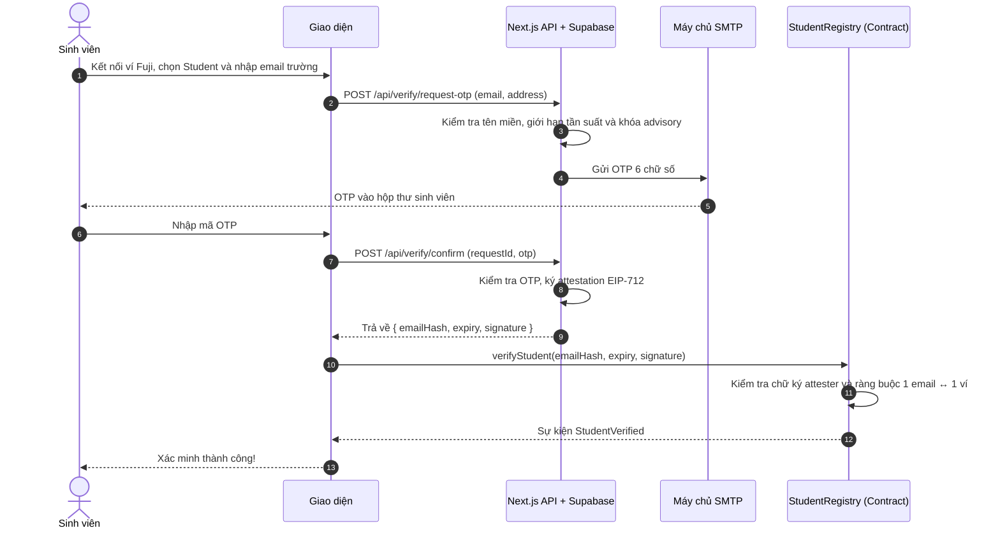
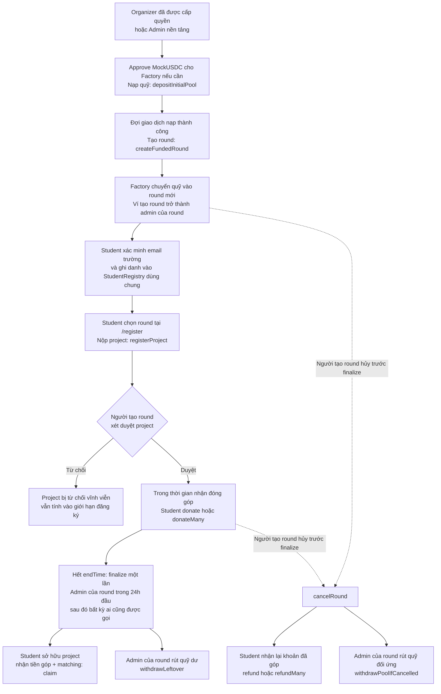

# SqrtFund — Democratic Quadratic Funding for Student Initiatives

> **Topic 6: Avalanche Hackathon (Team1 Vietnam)**  
> **Team:** 43xTSD  
> **Network:** Avalanche Fuji Testnet (Chain ID: `43113`)  
> **Live Web Application:** [https://www.sqrtfund.tech/](https://www.sqrtfund.tech/)  
> **Demo Video:** [Điền link YouTube/Loom demo video tại đây]  
> **Pitch Deck / Slides:** [Điền link Google Slides / PDF pitch deck tại đây]  

---

## Tóm tắt

**SqrtFund** là nền tảng gây quỹ cho câu lạc bộ và dự án sinh viên, dùng cơ chế **Quadratic Funding (QF)** trên **Avalanche Fuji**.

* **Vấn đề:** Quỹ hoạt động sinh viên thường được chia theo quan hệ hoặc theo người "nói to nhất". Dự án được nhiều bạn quan tâm nhưng không có người bảo trợ thì không nhận được gì.
* **Giải pháp:** Nhà tài trợ nạp một quỹ đối ứng. Sinh viên đã xác minh bằng email trường góp những khoản nhỏ (1–5 USDC) cho dự án mình thích. Quỹ đối ứng được phân bổ theo công thức QF, khuyến khích **nhiều người cùng ủng hộ** thay vì chỉ dựa vào tổng tiền góp. Ví dụ: 100 ví góp 1 USDC nhận matching thô gấp khoảng **5,2 lần** so với 20 ví góp 5 USDC, dù cùng tổng 100 USDC.
* **Điểm chính:** Công thức QF chạy hoàn toàn on-chain; xác minh sinh viên một lần bằng email trường + OTP + chữ ký EIP-712 và dùng chung cho mọi vòng; hỗ trợ quyên góp theo lô (`donateMany`), hủy vòng khẩn cấp và hoàn tiền 100% cho người góp.

---

## 1. Dự án làm gì

### Vấn đề

Câu lạc bộ sinh viên và các nhóm nghiên cứu nhỏ rất khó xin được kinh phí:

1. **Phân bổ theo quan hệ:** Quỹ về tay người có quan hệ hoặc người thuyết trình "to tiếng" nhất.
2. **Người giàu quyết định:** Trong gây quỹ thông thường, vài khoản góp lớn chi phối toàn bộ kết quả.
3. **Thiếu minh bạch:** Tiền đi qua tài khoản ngân hàng riêng, không có dấu vết hay lịch sử công khai trên sổ cái.

### Giải pháp: Quadratic Funding

Nhà tài trợ cung cấp một quỹ đối ứng (Matching Pool). Sinh viên đã xác minh góp những khoản nhỏ cho dự án mình quan tâm. Khi vòng kết thúc, quỹ được chia theo công thức QF — công thức này thưởng cho **số người ủng hộ** thay vì số tiền:

$$\text{Match}_j \propto \left(\sum_{i} \sqrt{d_{i,j}}\right)^2 - \sum_{i} d_{i,j}$$

trong đó $d_{i,j}$ là khoản sinh viên $i$ góp cho dự án $j$. Dự án có nhiều sinh viên ủng hộ nhận matching cao hơn nhiều so với dự án chỉ có một người góp lớn.

### Ba vai trò chính trong hệ thống

SqrtFund có **3 vai trò nghiệp vụ: Student, Organizer và Admin**. Quyền thực tế được kiểm tra trên smart contract; chọn hồ sơ trong menu ví không tự cấp quyền.

| Vai trò | Có thể làm gì | Nguồn xác định quyền |
| :--- | :--- | :--- |
| **Student — Sinh viên** | Xác minh email trường một lần; chọn vòng tài trợ và đăng ký dự án/CLB; đóng góp cho dự án đã được duyệt; theo dõi dự án, khoản góp và matching; nhận tiền dự án sau khi vòng được chốt hoặc hoàn lại khoản góp nếu vòng bị hủy. | `StudentRegistry.isStudent(wallet)` trên registry dùng chung. |
| **Organizer — Nhà tổ chức** | Xác thực email liên hệ và nộp đơn xin quyền. Sau khi được Admin cấp quyền: nạp quỹ ban đầu, tạo round và quản lý **round do ví mình tạo** — duyệt/từ chối project, bổ sung quỹ, chốt hoặc hủy vòng. Khi bị thu hồi quyền, có thể xem lý do và nộp lại đơn. | `RoundFactory.authorizedOrganizers(wallet)` cho quyền tạo round; `QFRound.admin()` cho quyền quản lý từng round. |
| **Admin — Quản trị nền tảng (Platform Owner)** | Có quyền nạp quỹ và tạo round như Organizer mà không cần tự nộp đơn; quản lý round mình tạo. Ngoài ra, xem đơn Organizer, cấp quyền on-chain, từ chối đơn và thu hồi quyền kèm lý do. | `RoundFactory.owner()`; quản lý round vẫn yêu cầu ví trùng `QFRound.admin()`. |

**Các tên gọi khác không phải vai trò nghiệp vụ riêng:**

- **Chủ dự án / Project Owner:** Student sở hữu project đã đăng ký. Không cần một tài khoản hay vai trò thứ tư; ví sở hữu project gọi `claim(projectId)` để nhận tiền.
- **Round Admin:** Quyền quản lý một round cụ thể. Factory cố định `admin = msg.sender` khi tạo round, nên người tạo round là người duyệt project trong round đó.
- **Guest:** Trạng thái chưa có quyền hoặc chưa kết nối ví, không phải một vai trò được cấp quyền trong quy trình nghiệp vụ.

**Phạm vi quyền cần phân biệt:**

- Admin nền tảng và Organizer **không tự có quyền duyệt project hoặc quản lý round của người khác**.
- Quyền tạo round không thay thế xác minh Student. Contract vẫn yêu cầu ví có quyền Student để đăng ký project hoặc donate; giao diện Organizer/Admin tập trung vào tác vụ quản trị.
- Thu hồi Organizer chỉ chặn tạo round mới và nạp quỹ ban đầu vào Factory; **không đổi admin của round đã tạo**, không xóa project hay tiền trên chain. Ví đó vẫn quản lý round cũ và rút được số dư nạp trước chưa sử dụng.
- Menu của Admin ẩn “Đăng ký dự án” và “Hoạt động của tôi” trên thanh điều hướng; dropdown ví có “Tạo round”, “Cấp quyền Organizer” và lối vào hoạt động cá nhân. Menu của các hồ sơ khác giữ luồng tương ứng.

### Tính năng

* **Xác minh sinh viên:** Email trường (`.edu`, `.edu.vn`) + OTP + attestation EIP-712, lưu một lần trong `StudentRegistry` dùng chung và có hiệu lực cho các vòng sử dụng registry đó.
* **Đăng ký và Quản trị Organizer:**
  * Người dùng chọn hồ sơ Organizer, xác thực OTP email liên hệ và nộp đơn; không bắt buộc xác minh Student trước khi xin quyền Organizer.
  * Ràng buộc **1 email ↔ 1 ví** cố định; khi bị thu hồi quyền email vẫn gắn với ví ban đầu để bảo vệ danh tính và hỗ trợ nộp lại (Re-apply).
  * **Platform Dashboard:** Platform Owner quản lý đơn theo tab (*Tất cả, Chờ duyệt, Đã duyệt, Từ chối, Đã thu hồi*).
  * **Quy tắc thu hồi quyền:** **Chỉ những đơn đã được phê duyệt thành công (`status = "approved"`) mới có thể thực hiện thao tác thu hồi quyền.**
  * **Modal thu hồi quyền:** Platform Owner xác nhận địa chỉ ví, thông tin tổ chức và bắt buộc nhập lí do thu hồi (tối thiểu 3 ký tự). Giao dịch gọi `setOrganizer(wallet, false)` on-chain và lưu lý do vào cơ sở dữ liệu.
  * **Giao diện khi bị thu hồi (Organizer View):** Dropdown ví có một banner “Quyền Organizer đã bị thu hồi” và một lối vào “Xem chi tiết & Gửi yêu cầu lại”. Lý do thu hồi và thao tác chỉnh hồ sơ/nộp lại nằm trong modal chi tiết, không lặp trong dropdown.
* **Prefunded Factory (Nạp quỹ trước khi tạo vòng):** Organizer hoặc Admin approve MockUSDC cho Factory nếu cần → gọi `depositInitialPool(token, amount)` → đợi xác nhận → gọi `createFundedRound(...)`. Factory trừ số dư đã nạp và chuyển quỹ vào round mới trong cùng giao dịch tạo vòng. `depositPool(amount)` là hàm khác, dùng để bổ sung quỹ cho **round đã tồn tại** và chỉ admin của round đó được gọi. Giao diện đọc lại số dư đã nạp trước khi tạo vòng; nếu giao dịch tạo vòng thất bại, thay đổi số dư và chuyển tiền được hoàn tác.
* **Factory nhiều vòng:** Mỗi vòng là một contract `QFRound` riêng, có thời gian, giới hạn góp, ngân sách và trần matching riêng.
* **Chọn vòng và đăng ký dự án:** `/register` có dropdown các vòng còn nhận đăng ký và dùng registry chung; hỗ trợ `/register?round=0x...` để chọn sẵn vòng từ trang chi tiết. Khi chưa có vòng phù hợp, hiển thị trạng thái trống thay vì báo nhầm lỗi xác minh Student. Vòng được yêu cầu đã đóng/không hợp lệ thì phải chọn lại, không tự chuyển sang vòng khác.
* **Danh sách round:** `/round` hiển thị tối đa 6 thẻ/trang, mới nhất trước, lọc trước khi phân trang. Đổi tab về trang 1; `?page=2` chia sẻ được và giữ khi quay lại. Mobile 1 cột, tablet (`md`) 2 cột, desktop (`lg`) 3 cột; skeleton 6 thẻ. Thanh phân trang dùng chung với danh sách duyệt dự án và đơn Organizer (giữ 4 mục/trang).
* **Giao diện đen–đỏ:** màu nền, thẻ, chữ, nhấn và nút tập trung tại `src/app/globals.css`; tăng sáng chữ phụ, nhãn tối thiểu 12px, focus ring rõ và tôn trọng reduced motion. Chạy `node scripts/check-ui-contrast.mjs` để kiểm tra các cặp màu AA; xem bảng trước/sau tại `docs/UI_ACCESSIBILITY.md`.
* **Duyệt dự án:** Student nộp project vào đúng round đã chọn; chỉ ví tạo round đó được duyệt hoặc từ chối. Danh sách duyệt project và danh sách đơn Organizer đều phân trang tối đa **4 mục/trang**, mới nhất trước.
* **Góp đơn lẻ và theo lô:** `donate` cho một dự án hoặc `donateMany` để chia ngân sách cho nhiều dự án trong một giao dịch duy nhất (cần approve ERC-20 nếu allowance chưa đủ).
* **Đếm người ủng hộ:** `donorCount` được lưu on-chain theo từng project; một ví donate nhiều lần cho cùng project không bị đếm lặp.
* **Bộ máy QF on-chain:** Tính bằng số nguyên với độ chính xác $\text{SCALE} = 10^{12}$, kèm tính toán mô phỏng matching dự kiến ngay trên giao diện khi sinh viên nhập số tiền.
* **Chống thiếu quỹ:** Nếu tổng nhu cầu matching vượt quá quỹ, các khoản chi được giảm theo tỷ lệ tương ứng.
* **Trần matching mỗi dự án:** `maxMatchBps` giới hạn phần trăm tối đa của quỹ mà một dự án được nhận.
* **Quyền chốt vòng theo thời gian:** Sau `endTime`, chỉ admin của round được chốt trong 24 giờ đầu; hết thời gian ân hạn thì bất kỳ ai cũng có thể gọi `finalize`. Mỗi vòng chỉ chốt một lần.
* **Nhận tiền trực tiếp:** Chủ dự án nhận tiền góp cộng matching thẳng từ contract của vòng.
* **Hủy vòng và hoàn tiền:** Admin có thể hủy vòng trước khi chốt; người góp sau đó nhận lại 100% số đã góp (`refund` / `refundMany`), và admin chỉ rút lại phần quỹ do chính mình nạp.

---

## 2. Cách hoạt động

### Xác minh sinh viên (Student Verification)



> **Lưu ý:** Attestation do khóa attester ở backend ký, còn contract tự kiểm tra chữ ký, thời hạn và ràng buộc một email một ví. Đây không phải là email zero-knowledge (ZK-Email).

### Cấp quyền Organizer

1. Người dùng chọn hồ sơ **Organizer**, nhập tổ chức/CLB, email liên hệ và kế hoạch tổ chức vòng tài trợ.
2. Xác thực email liên hệ bằng OTP qua `/api/organizer-applications/email`, rồi gửi đơn qua `POST /api/organizer-applications`. Xác thực email **chưa cấp quyền Organizer**.
3. **Admin nền tảng** vào `/admin?tab=platform` để xét đơn:
   - **Duyệt:** gửi giao dịch `setOrganizer(wallet, true)` → đợi giao dịch thành công → ký thông điệp quyết định → API cập nhật đơn thành `approved`.
   - **Từ chối:** ký thông điệp quyết định và cập nhật đơn thành `rejected`; không có giao dịch cấp quyền.
   - **Thu hồi:** chỉ áp dụng với đơn `approved`; nhập lý do → `setOrganizer(wallet, false)` → xác nhận giao dịch → ký thông điệp → API lưu trạng thái `revoked` và lý do.
4. Organizer bị thu hồi xem lý do trong modal chi tiết và có thể chỉnh hồ sơ để nộp lại. Các round đã tạo vẫn thuộc quyền quản lý của ví tạo round.

Backend xác thực chữ ký bằng owner hiện tại của Factory, ràng buộc chain/Factory/phiên bản đơn. Nếu người duyệt hủy bước ký sau khi giao dịch cấp hoặc thu hồi quyền đã thành công, quyền on-chain đã đổi nhưng trạng thái đơn chưa hoàn tất cập nhật. Xem [chi tiết phân quyền và ký quyết định](docs/platform-admin-access.md).

Admin nền tảng có thể tạo round ngay, không cần đi qua quy trình xin quyền Organizer.

### Vòng đời một vòng gọi vốn (Round Lifecycle)



**Các mốc thời gian và giới hạn:**

- Xác minh Student độc lập với việc tạo round; sơ đồ trên biểu diễn các bước cần có, không bắt buộc Student chờ tạo round mới được xác minh.
- Đăng ký và duyệt project có thể diễn ra **trước `startTime`**, nhưng phải trước `endTime`. Giao diện không cho đăng ký/duyệt khi vòng đã chốt hoặc bị hủy.
- Donate chỉ diễn ra trong khoảng `startTime <= thời gian hiện tại < endTime`, với project đã duyệt. Chủ project không được donate cho chính project của mình.
- Mỗi ví đăng ký tối đa **2 project/round**, toàn round tối đa **50 project**; project bị từ chối vẫn chiếm hạn mức. Khoản góp tuân theo `minDonation`, tổng góp mỗi project không vượt `maxDonation`, và tổng ngân sách mỗi ví không vượt `maxPerRound`.
- “1–5 USDC” là cấu hình minh họa của luồng demo; giới hạn thực tế lấy từ contract của từng round.
- Chưa có vòng trên Factory mới thì Student vẫn xác minh được, nhưng chưa thể nộp project. Cần Admin hoặc Organizer tạo vòng đầu tiên.

### Dữ liệu nằm ở đâu và ứng dụng gọi như thế nào?

| Thành phần | Dữ liệu / tác vụ |
| :--- | :--- |
| **Avalanche Fuji — smart contract** | `RoundFactory` lưu danh sách round, quyền tạo round và số dư nạp trước; mỗi `QFRound` lưu project, trạng thái duyệt/từ chối, khoản góp, matching, payout và hoàn tiền; `StudentRegistry` lưu trạng thái ví Student và ràng buộc hash email. |
| **Next.js API + Supabase** | OTP, dữ liệu xác minh email, định danh email–ví, hồ sơ/đơn Organizer, quyết định xét đơn, hash giao dịch và lý do thu hồi. Hồ sơ trên DB không thay thế quyền trên contract. |
| **Zustand** | Đẩy dữ liệu giao diện tức thì qua store round, project theo round và quyền/đơn Organizer theo ví; component danh sách đọc từ store. |
| **Axios + TanStack Query** | Axios gọi API của ứng dụng; TanStack Query lấy và xác nhận dữ liệu, quản lý cache, loading/error và tải lại. Axios client chung ở `src/lib/api.ts`. |
| **Polling / realtime** | Đồng bộ giữa hai máy: polling mỗi 5 giây khi tab hiển thị; tín hiệu realtime yêu cầu đọc lại dữ liệu, polling là phương án dự phòng. |
| **wagmi + viem** | Đọc dữ liệu contract qua RPC Fuji; gửi giao dịch có chữ ký ví khi tạo vòng, đăng ký/duyệt project, donate hoặc nhận tiền. Các thao tác này không phải API REST ghi round/project vào Supabase. |

Khi tải trang, dữ liệu từ TanStack Query/API được nạp vào Zustand; sau receipt thành công, giao diện cập nhật lạc quan bằng dữ liệu đã biết rồi đọc lại chain tại block xác nhận để ghi đè. Nếu bước xác nhận lỗi, patch được hoàn tác và polling thử đồng bộ lại; quyền thực tế vẫn do contract quyết định, store chỉ phản ánh dữ liệu. Xem [hướng dẫn thử bằng hai trình duyệt và kết quả kiểm tra](docs/UI-SYNC-TESTING.md).

Luồng API chính: `POST /api/verify/request-otp` → `POST /api/verify/confirm` cho Student; `POST /api/organizer-applications/email` cho OTP liên hệ; `GET`/`POST`/`PATCH /api/organizer-applications` để đọc/nộp/xét đơn Organizer. API trả dữ liệu xác minh/quyết định; quyền on-chain chỉ thay đổi sau giao dịch tương ứng.

---

## 3. Toán học của Quadratic Funding

Với các dự án đã duyệt $j = 1 \dots M$ và các khoản góp $d_{i,j}$ của sinh viên đã xác minh $i$:

1. **Tổng căn bậc hai:**  
   $$S_j = \sum_i \sqrt{d_{i,j}}$$
2. **Matching thô:**  
   $$\text{raw}_j = \max\left(0,\ \dfrac{S_j^2}{\text{SCALE}} - \sum_i d_{i,j}\right)$$
3. **Khớp với quỹ đối ứng:**  
   Nếu $\sum_j \text{raw}_j > \text{Pool}$ thì:
   $$\text{base}_j = \left\lfloor \dfrac{\text{Pool} \cdot \text{raw}_j}{\sum_j \text{raw}_j} \right\rfloor$$
   Ngược lại:
   $$\text{base}_j = \text{raw}_j$$
4. **Trần mỗi dự án:**  
   $$\text{cap} = \left\lfloor \dfrac{\text{Pool} \cdot \text{maxMatchBps}}{10000} \right\rfloor \quad \text{và} \quad \text{payout}_j = \min(\text{base}_j, \text{cap})$$
5. **Phần dư:**  
   $$\text{Remainder} = \text{Pool} - \sum_j \text{payout}_j \quad \text{(rút về cho admin)}$$

### Ví dụ so sánh

So sánh trường hợp 100 ví góp 1 USDC mỗi ví với 20 ví góp 5 USDC mỗi ví. Cả hai dự án đều nhận được cùng 100 USDC tiền góp trực tiếp:

| Kịch bản | Tiền góp trực tiếp | Matching thô |
| :--- | :---: | :---: |
| **100 ví × 1 USDC** | 100 USDC | **9.900 USDC** |
| **20 ví × 5 USDC** | 100 USDC | **1.900 USDC** |

Tỷ lệ matching thô chênh lệch khoảng **5,2 lần**. Với quỹ 10.000 USDC, tổng nhu cầu ($11.800$) vượt quỹ nên các khoản chi được giảm theo tỷ lệ xuống còn khoảng $8.390$ và $1.610$ USDC. Nếu có trần $30\%$, dự án thứ nhất bị giới hạn ở $3.000$ USDC.

> Tỷ lệ thô không phải là tỷ lệ nhận tiền thực tế: số tiền thật còn phụ thuộc vào quy mô quỹ và trần áp dụng.

### Tham số của vòng

| Tham số | Ý nghĩa |
| :--- | :--- |
| `minDonation` / `maxDonation` | Khoản góp nhỏ nhất một lần và tổng nhiều nhất một sinh viên được góp cho một dự án (ví dụ: 1 và 5 USDC). |
| `maxPerRound` | Tổng số tiền một sinh viên được chi cho mọi dự án trong một vòng (ví dụ: 10 USDC). |
| `maxMatchBps` | Trần matching mỗi dự án, tính theo điểm cơ bản (bps, $100\text{ bps} = 1\%$) của quỹ đối ứng. |
| `MAX_PROJECTS = 50` | Số dự án tối đa mỗi vòng, để hàm `finalize` luôn chạy trong $O(N)$ có giới hạn gas. |
| `MAX_PROJECTS_PER_OWNER = 2` | Hạn chế một địa chỉ ví đăng ký quá nhiều dự án. |

`finalize` lặp qua tối đa 50 dự án. Một kiểm thử Foundry cục bộ với 50 dự án đo được khoảng 1,58 triệu gas cho lệnh gọi này.

---

## 4. Chống lạm dụng

QF chỉ công bằng khi mỗi ví đại diện cho một con người thực. SqrtFund thiết lập nhiều lớp bảo vệ:

| Lớp bảo vệ | Thực thi bởi | Mục đích ngăn chặn |
| :--- | :--- | :--- |
| **Chỉ email trường** | Backend kiểm tra tên miền (`.edu`, `.edu.vn`) | Bot sử dụng email rác hoặc email dùng một lần. |
| **Một email ↔ một ví** | `StudentRegistry` (`emailOwner`, `walletEmail`) | Một email xác minh nhiều ví, hoặc một ví liên tục đổi email. |
| **Ngân sách mỗi sinh viên** | `spentInRound[donor] <= maxPerRound` on-chain | Giới hạn thiệt hại nếu kẻ tấn công sở hữu nhiều danh tính. |
| **Cộng dồn trước khi lấy căn** | `donationOf` cộng dồn theo ví và dự án | Việc chia 5 USDC thành 5 lần 1 USDC không thể tăng thêm matching. |
| **Giới hạn tần suất và khóa** | Khóa advisory của Supabase, sliding window rate limit | Tấn công tranh chấp đồng thời (race condition) và spam gửi mail OTP. |
| **Duyệt dự án** | Admin duyệt hoặc từ chối từng dự án | Dự án rác, spam hoặc lừa đảo. |

---

## 5. Giả định tin cậy và giới hạn đã biết

1. **Khóa attester:** Backend giữ `ATTESTER_PRIVATE_KEY` và ký attestation cho sinh viên. Nếu khóa bị lộ, kẻ tấn công có thể giả mạo attestation cho đến khi owner đổi khóa bằng `setAttester`. Khóa attester nên là một ví riêng biệt, tách biệt với admin của vòng.
2. **Phạm vi của Supabase:** Cơ sở dữ liệu phục vụ xác minh email, định danh email–ví và quy trình đơn Organizer, bao gồm lý do thu hồi quyền. Dữ liệu round, project, khoản góp, matching và payout nằm on-chain. Module đơn Organizer hiện có fallback bộ nhớ khi không truy cập được DB; fallback này không bền vững qua lần khởi động lại và không thay thế cấu hình Supabase cho môi trường triển khai.
3. **Quyền của người tạo round:** Ví tạo round là admin của round đó, có quyền duyệt hoặc từ chối dự án, chốt vòng trong 24 giờ ân hạn, và có thể hủy vòng bất kỳ lúc nào trước khi chốt, kể cả sau `endTime`. Khi hủy, người góp luôn nhận lại đủ 100% số đã góp và admin chỉ rút lại phần quỹ do mình nạp, nhưng các dự án sẽ mất phần matching.
4. **Nạp quỹ:** Nạp trước vào Factory (`depositInitialPool`) dành cho Organizer được cấp quyền hoặc Admin nền tảng; bổ sung vào round đã tạo (`depositPool`) chỉ dành cho admin của round. Nhà tài trợ bên ngoài cung cấp nguồn quỹ thông qua bên tổ chức, chưa có luồng nạp trực tiếp công khai cho mọi ví. Số dư nạp trước chưa dùng có thể rút bằng `withdrawInitialPool`, kể cả sau khi quyền Organizer bị thu hồi.
5. **Kiểm duyệt dự án:** Quyết định từ chối là vĩnh viễn trên chain, phát ra sự kiện `ProjectRejected(id)`, không lưu trữ lý do và không có cơ chế kháng nghị on-chain. Dự án bị từ chối vẫn tính vào giới hạn 50 dự án và giới hạn mỗi chủ ví.
6. **Danh tính qua email:** Hộp thư dùng chung hoặc địa chỉ email cựu sinh viên được trường cấp lại có thể tạo thêm danh tính.
7. **Thông đồng (Collusion):** QF thuần túy dễ bị mua chuộc (trả tiền để người khác góp hộ). Cơ chế Pairwise matching nằm trong lộ trình phát triển.
8. **Chưa kiểm toán:** Hợp đồng thông minh chưa qua kiểm toán an mật độc lập từ bên thứ ba.
9. **Store giao diện:** Zustand là bản phản chiếu tạm thời trong bộ nhớ; giữa hai thiết bị, đồng bộ dựa vào polling/realtime nên có thể trễ vài giây và phụ thuộc RPC/API.

---

## 6. Lý do thiết kế

### Vì sao on-chain?
Hội đồng xét duyệt truyền thống và bảng tính Excel thiếu tính minh bạch và chậm trễ. Khi triển khai on-chain:
* Công thức matching không thể bị chỉnh sửa hồi tố.
* Mỗi khoản góp là một giao dịch công khai, không thể làm giả.
* Chủ dự án nhận tiền trực tiếp từ smart contract theo quy tắc toán học đã chốt.

### Vì sao Avalanche?
Các khoản góp sinh viên rất nhỏ (1–5 USDC), do đó phí giao dịch là yếu tố sống còn:
* **Avalanche C-Chain** có mức phí cực thấp và tốc độ xác thực (finality) gần như tức thì.
* Sử dụng bộ công cụ EVM tiêu chuẩn, tương thích mượt mà với **Core Wallet**.
* Hàm `donateMany` cho phép sinh viên phân bổ ngân sách cho nhiều dự án trong 1 giao dịch, tối ưu tối đa chi phí gas.

### Tiền matching đến từ đâu?
Không đến từ lợi suất đầu cơ hay lạm phát token. Quỹ matching có thể do nhà trường, mạng lưới cựu sinh viên hoặc doanh nghiệp đối tác cung cấp cho bên tổ chức. Trong luồng hiện tại, Organizer/Admin nạp quỹ vào Factory bằng `depositInitialPool` trước khi tạo vòng; người tạo round có thể bổ sung quỹ qua `depositPool` trên round đó. Trong bản demo testnet này, token thử nghiệm là MockUSDC; việc nhà tài trợ nạp quỹ là kịch bản vận hành thực tế.

### Lưu ý pháp lý (Việt Nam)
SqrtFund vận hành thử nghiệm trên mạng Avalanche Fuji với MockUSDC (không có giá trị tiền tệ thực). Đây là công cụ công nghệ phân bổ quỹ tài trợ nghiên cứu/hoạt động, không cấu thành sản phẩm tài chính hoặc đầu tư. Nếu triển khai thực tế với tài sản thật, dự án cần tuân thủ đầy đủ quy định pháp luật Việt Nam về tài sản số và trung gian thanh toán.

---

## 7. Triển khai (Fuji)

Địa chỉ lấy từ `contracts/deployments/fuji.json`:

| Contract | Địa chỉ | Explorer |
| :--- | :--- | :--- |
| **StudentRegistry** | `0xbA0b756Ac2830743Cc56Fb42E504ED4d374Fe58e` | [Snowtrace](https://testnet.snowtrace.io/address/0xbA0b756Ac2830743Cc56Fb42E504ED4d374Fe58e) |
| **RoundFactory** | `0xB2A91fd342d4C81061A97C42A789253d2252D85E` | [Snowtrace](https://testnet.snowtrace.io/address/0xB2A91fd342d4C81061A97C42A789253d2252D85E) |
| **MockUSDC** | `0xFf56491e29085043DbB11cd01D54cC1449A3d686` | [Snowtrace](https://testnet.snowtrace.io/address/0xFf56491e29085043DbB11cd01D54cC1449A3d686) |

Bạn có thể kiểm tra trực tiếp các hợp đồng đã triển khai bằng lệnh `cast` của Foundry:

```bash
# 1. Kiểm tra Attester đã đăng ký trong StudentRegistry
cast call 0xbA0b756Ac2830743Cc56Fb42E504ED4d374Fe58e "attester()(address)" \
  --rpc-url https://api.avax-test.network/ext/bc/C/rpc
# Kỳ vọng: 0x5C2001c91aEFFaEDf9ef438cA50Bcddd23ce6181

# 2. Kiểm tra RoundFactory gắn với đúng StudentRegistry
cast call 0xB2A91fd342d4C81061A97C42A789253d2252D85E "studentRegistry()(address)" \
  --rpc-url https://api.avax-test.network/ext/bc/C/rpc
# Kỳ vọng: 0xbA0b756Ac2830743Cc56Fb42E504ED4d374Fe58e

# 3. Kiểm tra thông tin MockUSDC
cast call 0xFf56491e29085043DbB11cd01D54cC1449A3d686 "symbol()(string)" \
  --rpc-url https://api.avax-test.network/ext/bc/C/rpc
# Kỳ vọng: "USDC"
```

Mỗi vòng gọi vốn là một contract `QFRound` riêng do factory tạo ra. Để kiểm tra một vòng có dùng đúng StudentRegistry hay không, hãy gọi `studentRegistry()` trên địa chỉ contract của vòng đó.

---

## 8. Bắt đầu

### Yêu cầu tiên quyết
* **Node.js** 20+ và **pnpm**
* **Foundry** (`forge`, `cast`)
* Ví trình duyệt (khuyến nghị **Core Wallet**) kết nối mạng Avalanche Fuji, có một lượng nhỏ AVAX testnet làm gas.

### Cài đặt

```bash
git clone https://github.com/hlbaot/SqrtFund.git
cd SqrtFund
pnpm install
cd contracts && forge build && cd ..
```

### Biến môi trường

Sao chép `.env.example` thành `.env.local` và điền cấu hình phù hợp:

| Biến | Phạm vi | Mô tả |
| :--- | :--- | :--- |
| `NEXT_PUBLIC_CHAIN_ID` | Công khai | `43113` |
| `NEXT_PUBLIC_RPC_URL` | Công khai | `https://api.avax-test.network/ext/bc/C/rpc` |
| `NEXT_PUBLIC_EXPLORER_URL` | Công khai | `https://testnet.snowtrace.io` |
| `NEXT_PUBLIC_STUDENT_REGISTRY_ADDRESS` | Công khai | Địa chỉ hợp đồng `StudentRegistry` |
| `NEXT_PUBLIC_FACTORY_ADDRESS` | Công khai | Địa chỉ hợp đồng `RoundFactory` |
| `NEXT_PUBLIC_USDC_ADDRESS` | Công khai | Địa chỉ token `MockUSDC` |
| `ATTESTER_ADDRESS` | Server | Địa chỉ ví attester ký EIP-712 |
| `ATTESTER_PRIVATE_KEY` | Bí mật | Khóa bí mật của ví attester (chỉ lưu ở server) |
| `OTP_SECRET` | Bí mật | Khóa bí mật dùng để băm mã OTP |
| `SUPABASE_URL` | Server | URL dự án Supabase |
| `SUPABASE_SERVICE_ROLE_KEY` | Bí mật | Khóa service-role Supabase (chỉ dùng ở server) |
| `EMAIL_PROVIDER` | Server | `smtp` hoặc `resend` |
| `SMTP_HOST`, `SMTP_PORT`, `SMTP_FROM` | Server | Cấu hình máy chủ mail SMTP |
| `SMTP_USER`, `SMTP_PASS` | Bí mật | Thông tin xác thực tài khoản gửi mail |
| `ALLOWED_EMAIL_DOMAINS` | Server | Danh sách whitelist tên miền (tùy chọn; để trống sẽ chấp nhận mọi đuôi `.edu` và `.edu.vn`) |

> **Lưu ý:** Chỉ các biến có tiền tố `NEXT_PUBLIC_` mới được gửi tới trình duyệt. Các giá trị này được nhúng cố định khi build.

### Cơ sở dữ liệu

Thực thi lần lượt các file migration trong thư mục `supabase/migrations/` trong SQL Editor của Supabase:

1. `0001_verification.sql`: Khởi tạo bảng `otp_requests`, `verifications`, chỉ mục và hàm khóa advisory chống race-condition khi xác minh sinh viên.
2. `0002_organizer_applications.sql`: Tạo bảng `organizer_applications` lưu trữ hồ sơ đăng ký Organizer của các câu lạc bộ/tổ chức.
3. `0003_organizer_contact_otps.sql`: Bảng `organizer_contact_otps` phục vụ xác thực OTP qua email liên hệ của người nộp đơn Organizer.
4. `0004_email_wallet_identity.sql`: Bảng `email_wallet_bindings` và hàm `enforce_email_wallet` thiết lập ràng buộc định danh **1 email ↔ 1 ví** cố định chống tấn công Sybil.
5. `0005_revocation_reason.sql`: Mở rộng trạng thái `revoked`, bổ sung cột `revocation_reason` và chỉ mục phục vụ quy trình thu hồi quyền và kháng nghị/nộp lại của Organizer.

### Chạy và kiểm thử

```bash
# 1. Chạy ứng dụng Next.js ở chế độ phát triển (port 3000)
pnpm dev

# 2. Chạy test smart contract (đơn vị, fuzz và invariant)
cd contracts && forge test && cd ..

# 3. Chạy test frontend và backend API
pnpm test

# 4. Build kiểm tra bản production
pnpm build
```

### Tự triển khai contract

Với luồng **nạp USDC trước → tạo round**, dùng [hướng dẫn triển khai Prefunded Factory](docs/prefunded-factory-deployment.md). Kiểm tra Factory đang cấu hình bằng `pnpm check:factory` trước khi sử dụng; Factory chỉ có phân quyền Organizer có thể chưa có API nạp/rút trước khi tạo vòng.

```bash
cd contracts
export NEXT_PUBLIC_STUDENT_REGISTRY_ADDRESS=<địa_chỉ_registry>
forge script script/DeployFactory.s.sol:DeployFactory \
  --rpc-url https://api.avax-test.network/ext/bc/C/rpc \
  --account <keystore_của_bạn> --broadcast
```

Sau khi deploy, cập nhật các biến `NEXT_PUBLIC_*` và file `contracts/deployments/fuji.json`, sau đó tạo vòng mới từ giao diện trang Admin.

---

## 9. Dùng thử ứng dụng theo ba vai trò

### Chuẩn bị chung

- Kết nối Core Wallet hoặc ví EVM tương thích vào Avalanche Fuji (`43113`), có AVAX testnet để trả gas và MockUSDC cho thao tác nạp quỹ/donate. Có thể nhận AVAX từ [Avalanche Faucet](https://core.app/tools/testnet-faucet/); MockUSDC có tính năng faucet trên giao diện hoặc gọi contract theo cấu hình của token.
- Chuẩn bị ba ví nếu muốn demo tách biệt rõ ràng: **Admin** phải là owner hiện tại của Factory; một ví xin quyền **Organizer**; một ví xác minh **Student**. Chọn hồ sơ trong menu không biến một ví bất kỳ thành Admin.
- Triển khai đầy đủ migration, cấu hình mail/attester và kiểm tra `pnpm check:factory`. Factory chưa có round là trạng thái hợp lệ; tạo round ở bước Organizer/Admin trước khi thử đăng ký project.

### A. Admin cấp quyền Organizer

1. Ví Organizer chọn hồ sơ Organizer, nhập đơn đăng ký và xác thực OTP email liên hệ.
2. Ví Admin mở **Cấp quyền Organizer** (`/admin?tab=platform`), chọn đơn chờ duyệt.
3. Admin xác nhận giao dịch cấp quyền trên Fuji, sau đó ký quyết định để cập nhật trạng thái đơn.
4. Có thể thử từ chối đơn hoặc thu hồi quyền của đơn đã duyệt; Organizer xem lý do thu hồi trong modal và nộp lại nếu cần.

### B. Organizer hoặc Admin tạo và quản lý round

1. Mở **Tạo round** (`/admin?tab=organizer`); nhập tên vòng, đơn vị tổ chức, thời gian, ngân sách và các giới hạn đóng góp/matching.
2. Nạp MockUSDC vào Factory: approve ERC-20 nếu cần → `depositInitialPool` → đợi xác nhận.
3. Gọi `createFundedRound` để tạo vòng với quỹ đã nạp. Round xuất hiện trong **Vòng gọi vốn**; ví tạo vòng là người quản lý vòng đó.
4. Khi có project chờ duyệt, chọn đúng round trong trang quản trị và duyệt/từ chối. Chỉ người tạo round được thực hiện bước này, dù ví khác là Admin nền tảng.

### C. Student đăng ký, đóng góp và nhận tiền

1. Chọn hồ sơ Student và vào `/verify`; xác thực email trường bằng OTP, sau đó ký giao dịch ghi danh vào `StudentRegistry`. Chỉ nhận được OTP chưa đủ để có quyền Student on-chain.
2. Vào `/register`, chọn vòng tài trợ và nhập project/CLB. Nếu mở từ `/register?round=0x...`, form chọn sẵn vòng đó khi còn nhận đăng ký. Có nhiều vòng thì có thể chọn vòng muốn nộp; chưa có vòng phù hợp thì thấy thông báo chờ vòng mới.
3. Xác nhận giao dịch `registerProject`; project ở trạng thái chờ người tạo round duyệt. Theo dõi tại **Hoạt động của tôi**.
4. Trong thời gian donate, Student chọn project đã được duyệt của người khác; approve MockUSDC cho round nếu cần, rồi `donate` hoặc `donateMany`. Giao diện hiển thị matching dự kiến; kết quả cuối cùng chỉ có sau khi chốt vòng.
5. Sau `endTime`, người tạo round gọi `finalize` trong 24 giờ đầu; sau đó bất kỳ ví nào cũng có thể gọi. Student sở hữu project đã được duyệt vào **Hoạt động của tôi** để nhận tiền góp + matching bằng `claim`.
6. Nếu vòng bị hủy trước khi chốt, Student dùng `refund`/`refundMany` nhận lại khoản đã góp; admin của round rút lại quỹ đối ứng. Các giao dịch có liên kết kiểm tra trên Snowtrace.

---

## 10. Lộ trình phát triển

* **Attestation bằng ZK-Email:** Thay thế chữ ký backend bằng bằng chứng Zero-Knowledge Proofs dựa trên chữ ký DKIM của máy chủ email, loại bỏ hoàn toàn sự phụ thuộc vào máy chủ trung gian.
* **Pairwise Matching:** Tích hợp thuật toán giảm trọng số matching đối với các nhóm ví luôn cùng đóng góp cho một tập dự án giống nhau (chống hành vi thông đồng).
* **Số người ủng hộ tối thiểu (Quorum Threshold):** Đặt điều kiện số lượng sinh viên độc lập tối thiểu phải đạt được trước khi một dự án đủ điều kiện nhận matching.
* **Mở nạp quỹ cộng đồng:** Cho phép bất kỳ ai nạp thêm vào quỹ đối ứng và tự động hoàn lại phần dư theo tỷ lệ đóng góp của từng nhà tài trợ.
* **Thống kê ví duy nhất toàn vòng/nền tảng:** Bổ sung thống kê không đếm lặp một Student khi họ ủng hộ nhiều project; `donorCount` theo từng project hiện đã có on-chain.
* **Kiểm toán bảo mật:** Thực hiện kiểm toán an ninh hợp đồng thông minh toàn diện trước khi phát hành phiên bản mainnet.

---

## 11. Cấu trúc dự án

```text
SqrtFund/
├── contracts/
│   ├── src/
│   │   ├── MockUSDC.sol          # Token ERC-20 phục vụ thử nghiệm trên testnet
│   │   ├── QFRound.sol           # Toán QF, donate, finalize, claim, cancel, refund
│   │   ├── PrefundedQFRound.sol  # Round nhận quỹ ban đầu từ Factory
│   │   ├── RoundFactory.sol      # Quyền Organizer, số dư nạp trước và tạo round độc lập
│   │   └── StudentRegistry.sol   # Sổ đăng ký danh tính sinh viên dùng chung (EIP-712)
│   ├── test/                     # Bộ kiểm thử đơn vị, fuzz và invariant (Foundry)
│   ├── script/                   # Kịch bản triển khai smart contract
│   └── deployments/fuji.json     # Địa chỉ các hợp đồng đã triển khai trên Fuji
├── src/
│   ├── app/                      # App Router; API xác minh email và đơn Organizer
│   ├── components/               # Giao diện: admin, layout, project, round, verify...
│   ├── hooks/                    # Hook contract (wagmi/viem), API (TanStack Query), chọn round
│   ├── lib/                      # Axios client, toán QF, EIP-712, server và định dạng
│   │   └── store/                # Zustand: rounds, projects theo round, quyền/đơn Organizer
│   └── views/                    # Các view màn hình chính
├── supabase/migrations/          # Xác minh email, định danh ví, đơn Organizer và lý do thu hồi
├── __tests__/                    # Kiểm thử giao diện và API với Vitest
└── .env.example                  # File mẫu cấu hình biến môi trường
```

## CI và bản build

Workflow GitHub Actions kiểm tra frontend, contract và lưu bản build Next.js để tải về. Khi cả hai job đạt trên nhánh `main`, CD build và deploy production lên Vercel. Xem [hướng dẫn thiết lập CI](docs/ci.md) và [thiết lập CD Vercel](docs/vercel-cd.md) để cấu hình Variables, Secrets và môi trường Production.
